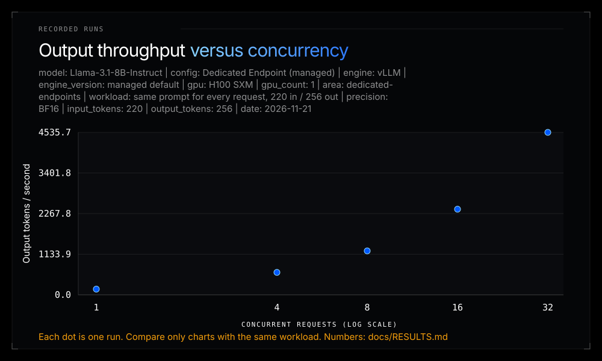

# Spheron GPU Benchmarks

LLM inference throughput and latency measured on cloud GPUs (B300, B200, H200, H100, RTX PRO 6000, L40S, A100 and more) with vLLM and SGLang. 490 dated load measurements from October and November 2026, every one tagged with model, GPU, engine, version, precision and workload, plus a small Python client to measure your own endpoint the same way.

Data and charts: [CC BY 4.0](LICENSE-DATA). Code: [MIT](LICENSE). Cite with [CITATION.cff](CITATION.cff) or the [snippet below](#how-to-cite).

## Key findings

Each finding names its rows (`row_id` in [data/catalog.csv](data/catalog.csv)) so you can check and quote the exact numbers. Output tok/s is output tokens per second summed across all concurrent requests.

**1. At high load, data parallel 8 with expert parallelism doubles Kimi-K2.7-Code throughput on 8x B300.** vLLM 0.31.0, NVFP4 weights, unique prompts of about 1k input and 512 output tokens, 120 s per level, 2026-10-09. DP8 with expert parallelism reached **22,419 output tok/s** at 1,024 concurrent requests. Plain tensor parallel 8 peaked at 11,342 tok/s at 512 (10,439 at 1,024), so the best result is about 2.0x the best plain one. Up to 256 concurrent requests plain TP8 is faster. Rows 316, 328, 329. [Chart](assets/charts/context-065.svg), [chart](assets/charts/context-074.svg).

**2. At high load, DP-attention plus expert parallelism keeps GLM-5.3 scaling on 8x B300.** SGLang 0.5.21, NVFP4, same workload as above. At 512 concurrent requests TP8 + DP-attention + EP8 gave 11,295 tok/s against 9,502 for plain TP8 (1.19x), and it reached **13,109 tok/s** at 1,024, a level where plain TP8 completed no requests within the timing window. Below 512 plain TP8 is faster. Rows 405, 406, 417. [Chart](assets/charts/context-059.svg), [chart](assets/charts/context-063.svg).

**3. vLLM and SGLang finish level on a dense 27B model on one B200.** Qwen3.8-27B (NVFP4 MLP, FP8 attention and KV), unique random prompts (no prefix cache hits, about 1k in / 512 out), 2026-10-08. At 256 concurrent requests vLLM 0.31.0 gave **7,490 tok/s** and SGLang 0.5.21 **7,460 tok/s**, a 0.4% gap; from 16 to 64 requests SGLang was 7% to 13% ahead. Median time to first token at 256 was 1.0 s for vLLM and 2.9 s for SGLang. Rows 117, 128. [Chart](assets/charts/context-080.svg), [chart](assets/charts/context-076.svg).

**4. One B200 serves Llama-3.3-70B FP8 at up to 1.8x the throughput of one H200 (vLLM on both).** Llama-3.3-70B-Instruct-FP8-dynamic on Dedicated Endpoints, 2026-11-21. With vLLM, 1x B200 led 1x H200 at every level: 1,051 against 727 tok/s at 16 concurrent requests (1.4x) and **2,004** against 1,093 at 32 (1.8x). SGLang on the H200 gave 1,412 tok/s at 32, so the B200 is 1.4x ahead of the H200's better engine. Rows 291, 292, 296, 297, 301. [Chart](assets/charts/context-008.svg), [chart](assets/charts/context-009.svg), [chart](assets/charts/context-007.svg).

**5. Single-GPU throughput for common models** (Spheron Dedicated Endpoints, 2026-11-21, 220 input tokens and up to 256 output tokens, the same prompt for every request, 32 concurrent requests, vLLM):

| Model | GPU | Output tok/s | Median TTFT | Row |
|---|---|---:|---:|---:|
| Llama-3.1-8B-Instruct (BF16) | 1x H100 SXM | 4,536 | 56 ms | 252 |
| Llama-3.1-8B-Instruct (BF16) | 1x RTX PRO 6000 | 2,490 | 100 ms | 247 |
| Llama-3.1-8B-Instruct (BF16) | 1x RTX 4090 | 1,422 | 87 ms | 242 |
| Llama-3.1-8B-Instruct (BF16) | 1x RTX 6000 Ada | 1,298 | 201 ms | 261 |
| Llama-3.1-8B-Instruct (BF16) | 1x RTX A6000 | 1,045 | 121 ms | 237 |
| Qwen3.8-27B-FP8 | 1x B200 | 2,660 | 170 ms | 179 |
| Qwen3.8-27B-FP8 | 1x H200 | 2,246 | 316 ms | 197 |
| Qwen3.8-27B-FP8 | 1x H100 SXM | 1,831 | 268 ms | 192 |
| Qwen3.8-27B-FP8 | 1x RTX PRO 6000 | 1,050 | 366 ms | 164 |
| Qwen3.8-27B-FP8 | 1x RTX 6000 Ada | 528 | 1,532 ms | 169 |

The prompt repeats in this workload, so prefix caching can lift these numbers above what unique traffic would see. Use them to compare GPUs and engines with each other. The engine version is the Dedicated Endpoints default on that day (`managed default`); the exact version was not recorded for these runs.

These are the clearest results, not the only ones. [docs/RESULTS.md](docs/RESULTS.md) has 102 charts with full numeric tables, grouped by study, and [docs/MODELS.md](docs/MODELS.md) lists all 16 models.

## What is in the data

| | |
|---|---:|
| Published measurements | 490 |
| Models / GPU models | 16 / 14 |
| Charts (exact contexts) / rows plotted | 102 / 448 |
| Date range | 2026-10-08 to 2026-11-21 |

Every row is one load measurement: one model on one GPU type served by one vLLM or SGLang engine, at a recorded concurrency, with its output throughput. Each row also carries its `date`, `gpu_count`, `engine_version`, `precision` and `workload`. Model, GPU and configuration labels are normalized (for example `Qwen/Qwen3.8-27B` becomes `Qwen3.8-27B`, and every H100 SXM5 label becomes `H100 SXM`); numbers are exactly as recorded. Where a field was not recorded the cell is empty and the docs say "not recorded"; the largest gap is engine version and precision on the 71 validation rows. Records that fail these rules or the data-quality checks (failed or invalid runs, overloaded levels, the SGLang concurrency-4 level on Dedicated Endpoints, duplicates) are left out; [PROVENANCE.md](docs/PROVENANCE.md#what-was-left-out) counts them by reason.

Rows come from four studies (`area` column):

| Area | Dates | What it covers |
|---|---|---|
| `dedicated-endpoints` | 2026-11-20 to 11-21 | Spheron Dedicated Endpoints: 14 GPU models from RTX A4000 to B300, one GPU, vLLM and SGLang. |
| `multi-gpu-tuning` | 2026-10-08 to 10-09 | B200 and B300, one to eight GPUs: tensor, data and expert parallelism, speculative decoding, KV cache and context options. |
| `large-model-validation` | 2026-10-10 to 10-21 | Validation sweeps of GLM-5.3, GLM-5.3-Flash, Kimi-K2.7-Code and DeepSeek-V4.1-Flash on 4x B300. |
| `single-node-sweeps` | 2026-11-07 to 11-18 | `vllm bench serve` sweeps and single-request image tests on one node. |

## Data layout

```
data/catalog.csv     one row per measurement (CSV)
data/catalog.json    the same rows as JSON, empty cells as null
data/summary.json    counts, date range, exclusions, column list
data/charts.json     every chart: the fixed context and the plotted rows
docs/RESULTS.md      102 charts grouped by study, each with a numeric table
docs/MODELS.md       every model with its rows, GPUs and dates
docs/DATA.md         schema for every file and column
docs/METHODOLOGY.md  how each area measured, metric definitions, limits
docs/PROVENANCE.md   source hash, what was excluded and why
assets/charts/       SVG charts (readable titles and descriptions)
benchmark.py         client for new measurements
scripts/             chart renderer and package validator
tests/               offline tests
```

Column definitions are in [docs/DATA.md](docs/DATA.md). Quick start with pandas (`pip install pandas`):

```python
import pandas as pd
df = pd.read_csv("data/catalog.csv")
endpoints = df[(df.area == "dedicated-endpoints") & (df.concurrency == 32)]
print(endpoints[["model", "gpu", "engine", "output_tok_s", "ttft_p50_ms", "date"]])
```

## How to read the charts



Each chart holds one exact context fixed (model, config, engine and version, GPU and count, area, workload, precision, input and output lengths, date) and plots output tok/s against concurrency. Each dot is one run; repeats at the same concurrency stay separate dots and nothing is averaged. Compare charts only when their workloads match: prompt length, prompt reuse and timing windows change throughput a lot. There is no single fastest-GPU ranking here and no confidence intervals: most contexts have one run per level.

## Reproduce

**Check a number.** Find its `row_id` in [data/catalog.csv](data/catalog.csv). The same row appears in [docs/RESULTS.md](docs/RESULTS.md) under its chart. Row ids are stable within a release version.

**Measure your own endpoint.** [benchmark.py](benchmark.py) needs Python 3.9 or newer and nothing else (no pip installs; tested on 3.9.6 and 3.12.14). Point it at any OpenAI-compatible chat completions URL you are allowed to load-test. Load tests can cost money and slow the endpoint for others, so start small.

[](https://app.spheron.ai)

The button opens the [Spheron app](https://app.spheron.ai) where you can deploy a GPU or a Dedicated Endpoint yourself; it does not start a benchmark. Then:

```sh
export OPENAI_API_KEY=...   # from your secret manager; never pass keys as arguments
python3 benchmark.py --url https://your-endpoint.example/v1/chat/completions \
  --model your-served-model --concurrency 1,4,8,16,32 --requests 64 \
  --warmup-requests 4 --input-words 160 --max-tokens 256 \
  --timeout 120 --output run-2026-11-23.json
```

The URL is the full chat completions path. HTTPS is required except on localhost, and redirects are refused. `--requests` must be at least the largest concurrency. `--input-words` is a word count, not tokens, so check `prompt_tokens` in the output. The client writes token rates only from the API's own usage numbers, never overwrites an existing file, and never stores the URL, key, prompts or responses. It exits with code 1 if any request failed. The output format (`spheron-sse-run-v1`) is in [docs/DATA.md](docs/DATA.md#benchmarkpy-output-spheron-sse-run-v1).

This client uses unique prompts and a fixed request count per level. That is close to, but not the same as, the methods behind the recorded rows (see [METHODOLOGY.md](docs/METHODOLOGY.md)), so expect your numbers to match the shape of the charts, not every value.

**Run the tests.** Offline, no network or GPU needed:

```sh
python3 -m unittest discover -s tests -v
python3 scripts/validate_package.py
```

The validator checks that the CSV, JSON, charts and docs agree with each other, that every number in the findings table matches its row, that links resolve and that no secrets are present.

## How to cite

> Spheron (2026). *Spheron GPU Benchmarks: LLM inference throughput and latency on cloud GPUs* (version 2026.11.23) [Data set]. https://github.com/spheronai/gpu-benchmarks

When quoting a single number, add its `row_id` and the version, for example: "22,419 output tok/s for Kimi-K2.7-Code on 8x B300 (Spheron GPU Benchmarks 2026.11.23, row 316)".

```bibtex
@misc{spheron_gpu_benchmarks_2026,
  author       = {{Spheron}},
  title        = {Spheron GPU Benchmarks: LLM inference throughput and latency on cloud GPUs},
  year         = {2026},
  version      = {2026.11.23},
  howpublished = {\url{https://github.com/spheronai/gpu-benchmarks}},
  note         = {Data set, CC BY 4.0}
}
```

## License

Data, charts and documentation are licensed under [Creative Commons Attribution 4.0 International](LICENSE-DATA): reuse them freely with credit to Spheron and a link to this repository. Code (`benchmark.py`, `scripts/`, `tests/`) is licensed under the [MIT License](LICENSE). Model, GPU and software names (including NVIDIA, vLLM and SGLang) are trademarks of their owners. This repository does not include or redistribute any model weights.
