# Results by Context

Every chart below holds one exact context fixed: model, configuration, engine and version, GPU and count, area, workload, precision, input and output lengths, and date. Only concurrency changes along the x axis. Each dot is one recorded run, so repeated runs at the same concurrency appear as separate dots. Values are the recorded output tokens per second, not re-measured or averaged.

490 published rows; 16 models; 14 GPU models. Dates: 2026-10-08 to 2026-11-21. Charts are grouped by study: [Spheron Dedicated Endpoints](#spheron-dedicated-endpoints), [Multi-GPU tuning on B200 and B300](#multi-gpu-tuning-on-b200-and-b300), [Large-model validation on B300](#large-model-validation-on-b300), [Single-node sweeps](#single-node-sweeps).

102 charts plot 448 of the 490 rows. The other rows belong to contexts with a single concurrency level and are in the CSV only.

Compare contexts only when their workloads match: prompt length, prompt reuse and timing windows change throughput a lot. "not recorded" means the field was not recorded for that run.

[Methodology](METHODOLOGY.md) | [Data schema](DATA.md) | [Provenance](PROVENANCE.md) | [Model index](MODELS.md) | [Full CSV](../data/catalog.csv) | [Chart manifest](../data/charts.json)

## Spheron Dedicated Endpoints

November 2026 runs on Spheron Dedicated Endpoints: one GPU, vLLM or SGLang as installed by default.

### Context 001

**Llama-3.1-8B-Instruct** on **1x H100 SXM**, SGLang (managed default), 2026-11-21

**model**: Llama-3.1-8B-Instruct | **config**: Dedicated Endpoint (managed) | **engine**: SGLang | **engine_version**: managed default | **gpu**: H100 SXM | **gpu_count**: 1 | **area**: dedicated-endpoints | **workload**: same prompt for every request, 220 in / 256 out | **precision**: BF16 | **input_tokens**: 220 | **output_tokens**: 256 | **date**: 2026-11-21

| Row | Concurrency | Output tok/s |
|---:|---:|---:|
| 253 | 1 | 158.8 |
| 254 | 8 | 1227.5 |
| 255 | 16 | 2354.1 |
| 256 | 32 | 4546.9 |

### Context 002

**Llama-3.1-8B-Instruct** on **1x H100 SXM**, vLLM (managed default), 2026-11-21

**model**: Llama-3.1-8B-Instruct | **config**: Dedicated Endpoint (managed) | **engine**: vLLM | **engine_version**: managed default | **gpu**: H100 SXM | **gpu_count**: 1 | **area**: dedicated-endpoints | **workload**: same prompt for every request, 220 in / 256 out | **precision**: BF16 | **input_tokens**: 220 | **output_tokens**: 256 | **date**: 2026-11-21

| Row | Concurrency | Output tok/s |
|---:|---:|---:|
| 248 | 1 | 159 |
| 249 | 4 | 626.3 |
| 250 | 8 | 1226.5 |
| 251 | 16 | 2390.7 |
| 252 | 32 | 4535.7 |

### Context 003

**Llama-3.1-8B-Instruct** on **1x RTX 4090**, vLLM (managed default), 2026-11-21

**model**: Llama-3.1-8B-Instruct | **config**: Dedicated Endpoint (managed) | **engine**: vLLM | **engine_version**: managed default | **gpu**: RTX 4090 | **gpu_count**: 1 | **area**: dedicated-endpoints | **workload**: same prompt for every request, 220 in / 256 out | **precision**: BF16 | **input_tokens**: 220 | **output_tokens**: 256 | **date**: 2026-11-21

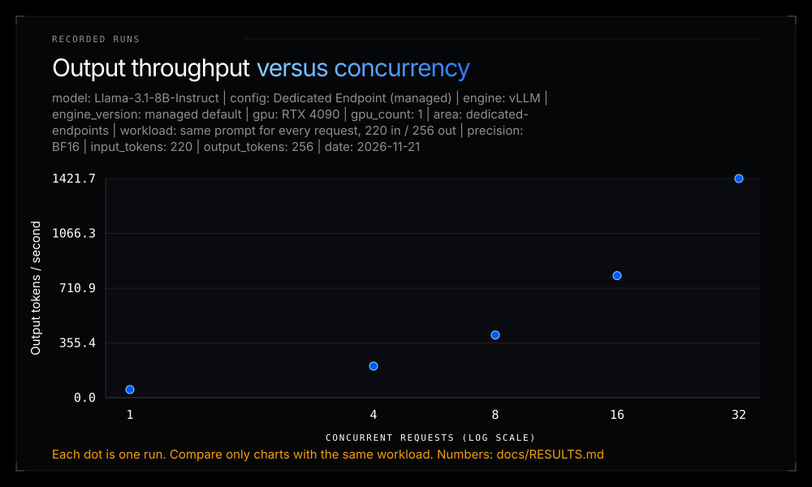

| Row | Concurrency | Output tok/s |
|---:|---:|---:|
| 238 | 1 | 53.1 |
| 239 | 4 | 205.3 |
| 240 | 8 | 406.8 |
| 241 | 16 | 792 |
| 242 | 32 | 1421.7 |

### Context 004

**Llama-3.1-8B-Instruct** on **1x RTX 6000 Ada**, vLLM (managed default), 2026-11-21

**model**: Llama-3.1-8B-Instruct | **config**: Dedicated Endpoint (managed) | **engine**: vLLM | **engine_version**: managed default | **gpu**: RTX 6000 Ada | **gpu_count**: 1 | **area**: dedicated-endpoints | **workload**: same prompt for every request, 220 in / 256 out | **precision**: BF16 | **input_tokens**: 220 | **output_tokens**: 256 | **date**: 2026-11-21

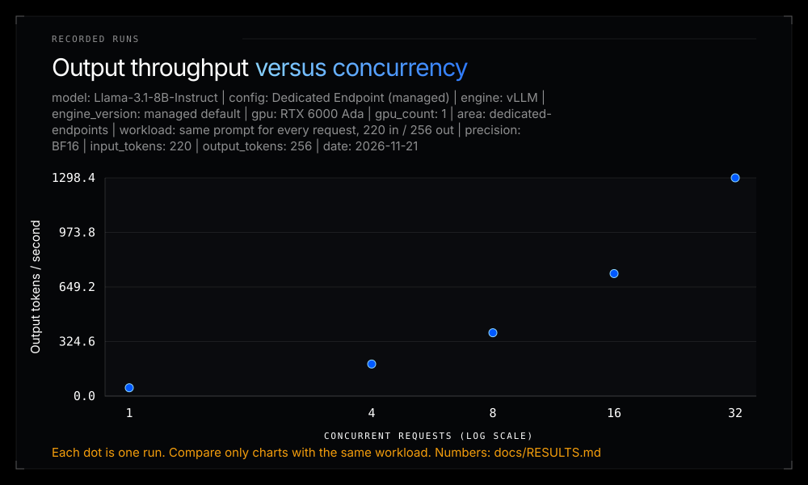

| Row | Concurrency | Output tok/s |
|---:|---:|---:|
| 257 | 1 | 49.5 |
| 258 | 4 | 190.7 |
| 259 | 8 | 376.8 |
| 260 | 16 | 728.8 |
| 261 | 32 | 1298.4 |

### Context 005

**Llama-3.1-8B-Instruct** on **1x RTX A6000**, vLLM (managed default), 2026-11-21

**model**: Llama-3.1-8B-Instruct | **config**: Dedicated Endpoint (managed) | **engine**: vLLM | **engine_version**: managed default | **gpu**: RTX A6000 | **gpu_count**: 1 | **area**: dedicated-endpoints | **workload**: same prompt for every request, 220 in / 256 out | **precision**: BF16 | **input_tokens**: 220 | **output_tokens**: 256 | **date**: 2026-11-21

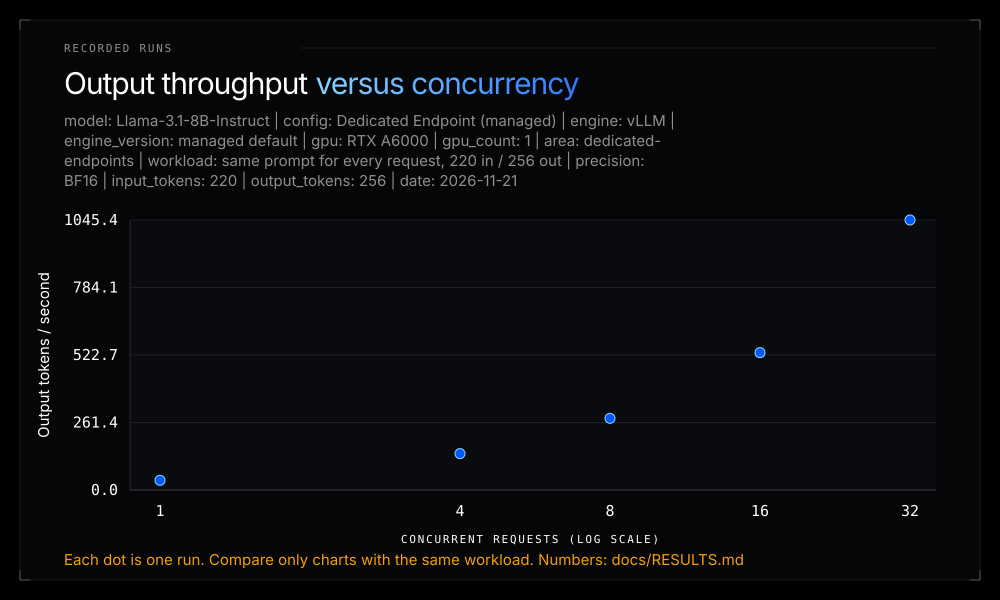

| Row | Concurrency | Output tok/s |
|---:|---:|---:|
| 233 | 1 | 37.5 |
| 234 | 4 | 140.9 |
| 235 | 8 | 277.4 |
| 236 | 16 | 531.8 |
| 237 | 32 | 1045.4 |

### Context 006

**Llama-3.1-8B-Instruct** on **1x RTX PRO 6000**, vLLM (managed default), 2026-11-21

**model**: Llama-3.1-8B-Instruct | **config**: Dedicated Endpoint (managed) | **engine**: vLLM | **engine_version**: managed default | **gpu**: RTX PRO 6000 | **gpu_count**: 1 | **area**: dedicated-endpoints | **workload**: same prompt for every request, 220 in / 256 out | **precision**: BF16 | **input_tokens**: 220 | **output_tokens**: 256 | **date**: 2026-11-21

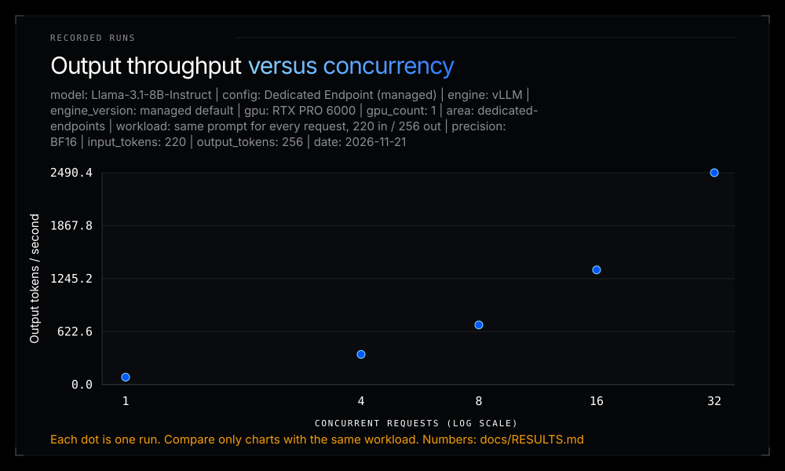

| Row | Concurrency | Output tok/s |
|---:|---:|---:|
| 243 | 1 | 87.9 |
| 244 | 4 | 355.8 |
| 245 | 8 | 701.8 |
| 246 | 16 | 1348.2 |
| 247 | 32 | 2490.4 |

### Context 007

**Llama-3.3-70B-Instruct-FP8-dynamic** on **1x H200**, SGLang (managed default), 2026-11-21

**model**: Llama-3.3-70B-Instruct-FP8-dynamic | **config**: Dedicated Endpoint (managed) | **engine**: SGLang | **engine_version**: managed default | **gpu**: H200 | **gpu_count**: 1 | **area**: dedicated-endpoints | **workload**: same prompt for every request, 220 in / 256 out | **precision**: FP8 | **input_tokens**: 220 | **output_tokens**: 256 | **date**: 2026-11-21

| Row | Concurrency | Output tok/s |
|---:|---:|---:|
| 298 | 1 | 48.8 |
| 299 | 8 | 381.1 |
| 300 | 16 | 739.6 |
| 301 | 32 | 1411.5 |

### Context 008

**Llama-3.3-70B-Instruct-FP8-dynamic** on **1x B200**, vLLM (managed default), 2026-11-21

**model**: Llama-3.3-70B-Instruct-FP8-dynamic | **config**: Dedicated Endpoint (managed) | **engine**: vLLM | **engine_version**: managed default | **gpu**: B200 | **gpu_count**: 1 | **area**: dedicated-endpoints | **workload**: same prompt for every request, 220 in / 256 out | **precision**: FP8 | **input_tokens**: 220 | **output_tokens**: 256 | **date**: 2026-11-21

| Row | Concurrency | Output tok/s |
|---:|---:|---:|
| 293 | 1 | 65.4 |
| 294 | 4 | 254.4 |
| 295 | 8 | 519.8 |
| 296 | 16 | 1051.3 |
| 297 | 32 | 2004.1 |

### Context 009

**Llama-3.3-70B-Instruct-FP8-dynamic** on **1x H200**, vLLM (managed default), 2026-11-21

**model**: Llama-3.3-70B-Instruct-FP8-dynamic | **config**: Dedicated Endpoint (managed) | **engine**: vLLM | **engine_version**: managed default | **gpu**: H200 | **gpu_count**: 1 | **area**: dedicated-endpoints | **workload**: same prompt for every request, 220 in / 256 out | **precision**: FP8 | **input_tokens**: 220 | **output_tokens**: 256 | **date**: 2026-11-21

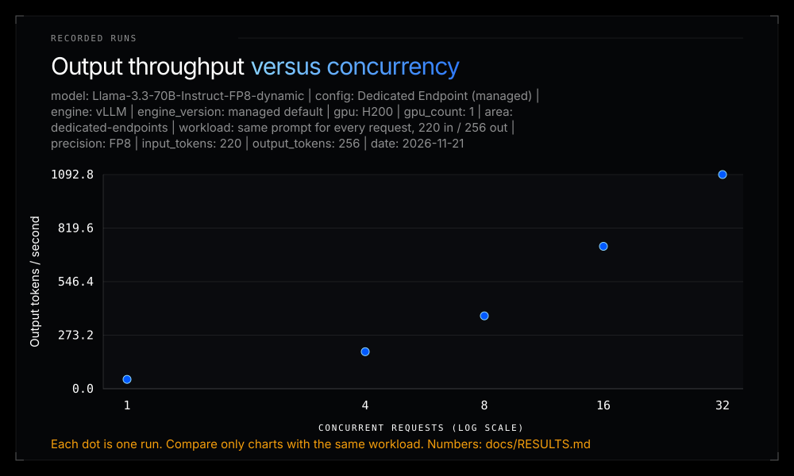

| Row | Concurrency | Output tok/s |
|---:|---:|---:|
| 288 | 1 | 47.8 |
| 289 | 4 | 188.9 |
| 290 | 8 | 371.8 |
| 291 | 16 | 726.6 |
| 292 | 32 | 1092.8 |

### Context 010

**Qwen2.5-1.5B-Instruct** on **1x B200**, SGLang (managed default), 2026-11-20

**model**: Qwen2.5-1.5B-Instruct | **config**: Dedicated Endpoint (managed) | **engine**: SGLang | **engine_version**: managed default | **gpu**: B200 | **gpu_count**: 1 | **area**: dedicated-endpoints | **workload**: same prompt for every request, 220 in / 256 out | **precision**: BF16 | **input_tokens**: 220 | **output_tokens**: 256 | **date**: 2026-11-20

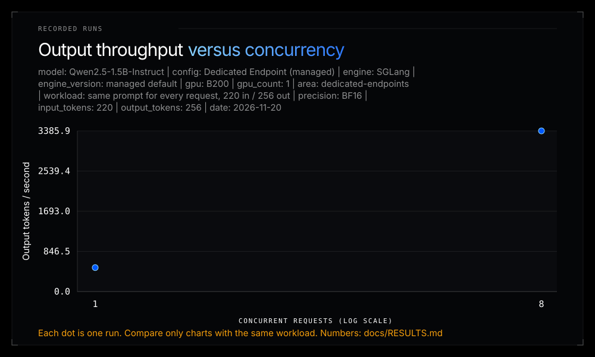

| Row | Concurrency | Output tok/s |
|---:|---:|---:|
| 43 | 1 | 505 |
| 44 | 8 | 3385.9 |

### Context 011

**Qwen2.5-1.5B-Instruct** on **1x H100 SXM**, SGLang (managed default), 2026-11-20

**model**: Qwen2.5-1.5B-Instruct | **config**: Dedicated Endpoint (managed) | **engine**: SGLang | **engine_version**: managed default | **gpu**: H100 SXM | **gpu_count**: 1 | **area**: dedicated-endpoints | **workload**: same prompt for every request, 220 in / 256 out | **precision**: BF16 | **input_tokens**: 220 | **output_tokens**: 256 | **date**: 2026-11-20

| Row | Concurrency | Output tok/s |
|---:|---:|---:|
| 41 | 1 | 358.1 |
| 42 | 8 | 3319.4 |

### Context 012

**Qwen2.5-1.5B-Instruct** on **1x RTX 4090**, SGLang (managed default), 2026-11-20

**model**: Qwen2.5-1.5B-Instruct | **config**: Dedicated Endpoint (managed) | **engine**: SGLang | **engine_version**: managed default | **gpu**: RTX 4090 | **gpu_count**: 1 | **area**: dedicated-endpoints | **workload**: same prompt for every request, 220 in / 256 out | **precision**: BF16 | **input_tokens**: 220 | **output_tokens**: 256 | **date**: 2026-11-20

| Row | Concurrency | Output tok/s |
|---:|---:|---:|
| 1 | 1 | 192 |
| 2 | 8 | 1308.1 |

### Context 013

**Qwen2.5-1.5B-Instruct** on **1x RTX A6000**, SGLang (managed default), 2026-11-20

**model**: Qwen2.5-1.5B-Instruct | **config**: Dedicated Endpoint (managed) | **engine**: SGLang | **engine_version**: managed default | **gpu**: RTX A6000 | **gpu_count**: 1 | **area**: dedicated-endpoints | **workload**: same prompt for every request, 220 in / 256 out | **precision**: BF16 | **input_tokens**: 220 | **output_tokens**: 256 | **date**: 2026-11-20

| Row | Concurrency | Output tok/s |
|---:|---:|---:|
| 27 | 1 | 156.8 |
| 28 | 8 | 1328.1 |

### Context 014

**Qwen2.5-1.5B-Instruct** on **1x RTX PRO 6000**, SGLang (managed default), 2026-11-20

**model**: Qwen2.5-1.5B-Instruct | **config**: Dedicated Endpoint (managed) | **engine**: SGLang | **engine_version**: managed default | **gpu**: RTX PRO 6000 | **gpu_count**: 1 | **area**: dedicated-endpoints | **workload**: same prompt for every request, 220 in / 256 out | **precision**: BF16 | **input_tokens**: 220 | **output_tokens**: 256 | **date**: 2026-11-20

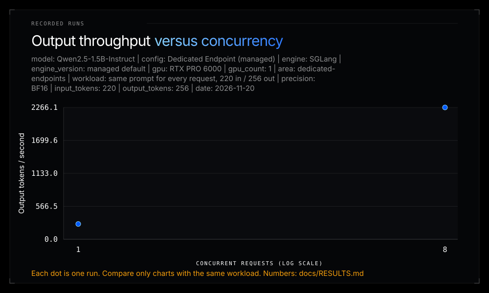

| Row | Concurrency | Output tok/s |
|---:|---:|---:|
| 45 | 1 | 263.2 |
| 46 | 8 | 2266.1 |

### Context 015

**Qwen2.5-1.5B-Instruct** on **1x A100 40GB SXM**, vLLM (managed default), 2026-11-20

**model**: Qwen2.5-1.5B-Instruct | **config**: Dedicated Endpoint (managed) | **engine**: vLLM | **engine_version**: managed default | **gpu**: A100 40GB SXM | **gpu_count**: 1 | **area**: dedicated-endpoints | **workload**: same prompt for every request, 220 in / 256 out | **precision**: BF16 | **input_tokens**: 220 | **output_tokens**: 256 | **date**: 2026-11-20

| Row | Concurrency | Output tok/s |
|---:|---:|---:|
| 15 | 1 | 211.2 |
| 16 | 4 | 937.2 |
| 17 | 8 | 1838.9 |

### Context 016

**Qwen2.5-1.5B-Instruct** on **1x A100 80GB PCIe**, vLLM (managed default), 2026-11-20

**model**: Qwen2.5-1.5B-Instruct | **config**: Dedicated Endpoint (managed) | **engine**: vLLM | **engine_version**: managed default | **gpu**: A100 80GB PCIe | **gpu_count**: 1 | **area**: dedicated-endpoints | **workload**: same prompt for every request, 220 in / 256 out | **precision**: BF16 | **input_tokens**: 220 | **output_tokens**: 256 | **date**: 2026-11-20

| Row | Concurrency | Output tok/s |
|---:|---:|---:|
| 21 | 1 | 228.1 |
| 22 | 4 | 1030.8 |
| 23 | 8 | 2026.9 |

### Context 017

**Qwen2.5-1.5B-Instruct** on **1x A40**, vLLM (managed default), 2026-11-20

**model**: Qwen2.5-1.5B-Instruct | **config**: Dedicated Endpoint (managed) | **engine**: vLLM | **engine_version**: managed default | **gpu**: A40 | **gpu_count**: 1 | **area**: dedicated-endpoints | **workload**: same prompt for every request, 220 in / 256 out | **precision**: BF16 | **input_tokens**: 220 | **output_tokens**: 256 | **date**: 2026-11-20

| Row | Concurrency | Output tok/s |
|---:|---:|---:|
| 47 | 1 | 140.1 |
| 48 | 4 | 561.5 |
| 49 | 8 | 1101.6 |

### Context 018

**Qwen2.5-1.5B-Instruct** on **1x B200**, vLLM (managed default), 2026-11-20

**model**: Qwen2.5-1.5B-Instruct | **config**: Dedicated Endpoint (managed) | **engine**: vLLM | **engine_version**: managed default | **gpu**: B200 | **gpu_count**: 1 | **area**: dedicated-endpoints | **workload**: same prompt for every request, 220 in / 256 out | **precision**: BF16 | **input_tokens**: 220 | **output_tokens**: 256 | **date**: 2026-11-20

| Row | Concurrency | Output tok/s |
|---:|---:|---:|
| 32 | 1 | 585.8 |
| 33 | 4 | 2214.1 |
| 34 | 8 | 4372.7 |

### Context 019

**Qwen2.5-1.5B-Instruct** on **1x B300**, vLLM (managed default), 2026-11-20

**model**: Qwen2.5-1.5B-Instruct | **config**: Dedicated Endpoint (managed) | **engine**: vLLM | **engine_version**: managed default | **gpu**: B300 | **gpu_count**: 1 | **area**: dedicated-endpoints | **workload**: same prompt for every request, 220 in / 256 out | **precision**: BF16 | **input_tokens**: 220 | **output_tokens**: 256 | **date**: 2026-11-20

| Row | Concurrency | Output tok/s |
|---:|---:|---:|
| 35 | 1 | 594 |
| 36 | 4 | 2234.5 |
| 37 | 8 | 4316.3 |

### Context 020

**Qwen2.5-1.5B-Instruct** on **1x H100 SXM**, vLLM (managed default), 2026-11-20

**model**: Qwen2.5-1.5B-Instruct | **config**: Dedicated Endpoint (managed) | **engine**: vLLM | **engine_version**: managed default | **gpu**: H100 SXM | **gpu_count**: 1 | **area**: dedicated-endpoints | **workload**: same prompt for every request, 220 in / 256 out | **precision**: BF16 | **input_tokens**: 220 | **output_tokens**: 256 | **date**: 2026-11-20

| Row | Concurrency | Output tok/s |
|---:|---:|---:|
| 29 | 1 | 433.4 |
| 30 | 4 | 1701.8 |
| 31 | 8 | 3300 |

### Context 021

**Qwen2.5-1.5B-Instruct** on **1x L4**, vLLM (managed default), 2026-11-20

**model**: Qwen2.5-1.5B-Instruct | **config**: Dedicated Endpoint (managed) | **engine**: vLLM | **engine_version**: managed default | **gpu**: L4 | **gpu_count**: 1 | **area**: dedicated-endpoints | **workload**: same prompt for every request, 220 in / 256 out | **precision**: BF16 | **input_tokens**: 220 | **output_tokens**: 256 | **date**: 2026-11-20

| Row | Concurrency | Output tok/s |
|---:|---:|---:|
| 18 | 1 | 74.9 |
| 19 | 4 | 295.9 |
| 20 | 8 | 585.3 |

### Context 022

**Qwen2.5-1.5B-Instruct** on **1x L40S**, vLLM (managed default), 2026-11-20

**model**: Qwen2.5-1.5B-Instruct | **config**: Dedicated Endpoint (managed) | **engine**: vLLM | **engine_version**: managed default | **gpu**: L40S | **gpu_count**: 1 | **area**: dedicated-endpoints | **workload**: same prompt for every request, 220 in / 256 out | **precision**: BF16 | **input_tokens**: 220 | **output_tokens**: 256 | **date**: 2026-11-20

| Row | Concurrency | Output tok/s |
|---:|---:|---:|
| 3 | 1 | 176.6 |
| 9 | 1 | 176.5 |
| 4 | 4 | 702.1 |
| 10 | 4 | 700.4 |
| 5 | 8 | 1398.6 |
| 11 | 8 | 1394.1 |

### Context 023

**Qwen2.5-1.5B-Instruct** on **1x RTX A4000**, vLLM (managed default), 2026-11-20

**model**: Qwen2.5-1.5B-Instruct | **config**: Dedicated Endpoint (managed) | **engine**: vLLM | **engine_version**: managed default | **gpu**: RTX A4000 | **gpu_count**: 1 | **area**: dedicated-endpoints | **workload**: same prompt for every request, 220 in / 256 out | **precision**: BF16 | **input_tokens**: 220 | **output_tokens**: 256 | **date**: 2026-11-20

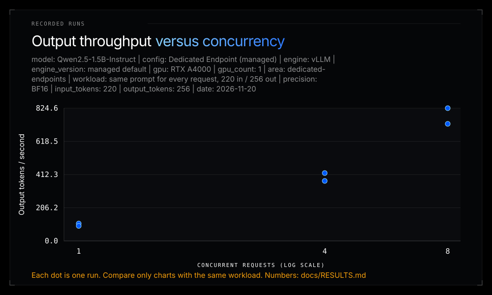

| Row | Concurrency | Output tok/s |
|---:|---:|---:|
| 6 | 1 | 107.9 |
| 24 | 1 | 93.3 |
| 7 | 4 | 421.6 |
| 25 | 4 | 372.7 |
| 8 | 8 | 824.6 |
| 26 | 8 | 727.3 |

### Context 024

**Qwen2.5-1.5B-Instruct** on **1x RTX PRO 6000**, vLLM (managed default), 2026-11-20

**model**: Qwen2.5-1.5B-Instruct | **config**: Dedicated Endpoint (managed) | **engine**: vLLM | **engine_version**: managed default | **gpu**: RTX PRO 6000 | **gpu_count**: 1 | **area**: dedicated-endpoints | **workload**: same prompt for every request, 220 in / 256 out | **precision**: BF16 | **input_tokens**: 220 | **output_tokens**: 256 | **date**: 2026-11-20

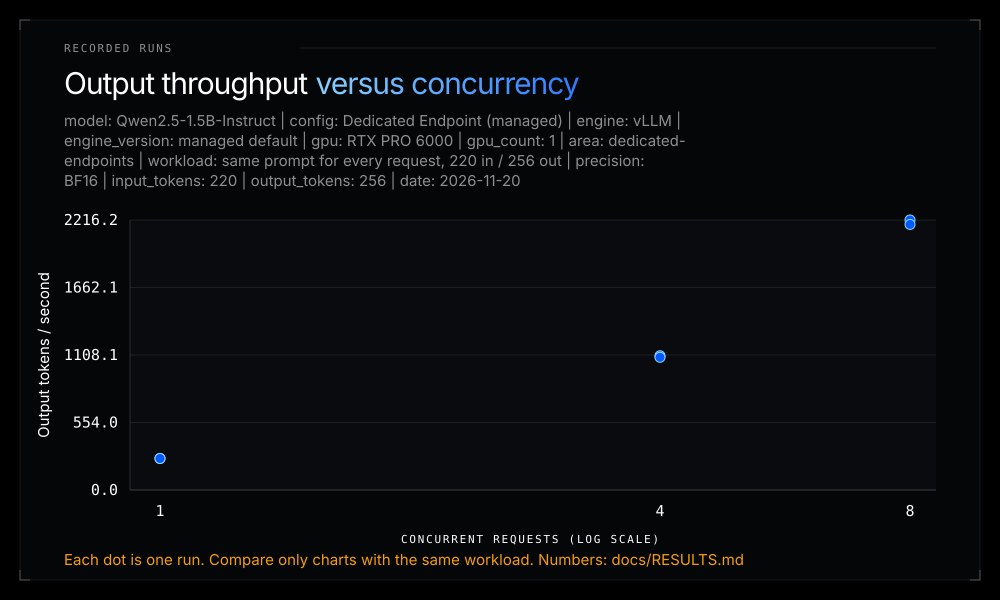

| Row | Concurrency | Output tok/s |
|---:|---:|---:|
| 12 | 1 | 258.9 |
| 38 | 1 | 258.7 |
| 13 | 4 | 1101.9 |
| 39 | 4 | 1089.4 |
| 14 | 8 | 2216.2 |
| 40 | 8 | 2180 |

### Context 025

**Qwen3.5-9B** on **1x H100 SXM**, SGLang (managed default), 2026-11-21

**model**: Qwen3.5-9B | **config**: Dedicated Endpoint (managed) | **engine**: SGLang | **engine_version**: managed default | **gpu**: H100 SXM | **gpu_count**: 1 | **area**: dedicated-endpoints | **workload**: same prompt for every request, 220 in / 256 out | **precision**: BF16 | **input_tokens**: 220 | **output_tokens**: 256 | **date**: 2026-11-21

| Row | Concurrency | Output tok/s |
|---:|---:|---:|
| 69 | 1 | 154.4 |
| 70 | 8 | 1151.9 |
| 71 | 16 | 2026.2 |
| 72 | 32 | 3871.8 |

### Context 026

**Qwen3.5-9B** on **1x H100 SXM**, vLLM (managed default), 2026-11-21

**model**: Qwen3.5-9B | **config**: Dedicated Endpoint (managed) | **engine**: vLLM | **engine_version**: managed default | **gpu**: H100 SXM | **gpu_count**: 1 | **area**: dedicated-endpoints | **workload**: same prompt for every request, 220 in / 256 out | **precision**: BF16 | **input_tokens**: 220 | **output_tokens**: 256 | **date**: 2026-11-21

| Row | Concurrency | Output tok/s |
|---:|---:|---:|
| 64 | 1 | 153.7 |
| 65 | 4 | 589.7 |
| 66 | 8 | 1123.6 |
| 67 | 16 | 2106.5 |
| 68 | 32 | 3770.2 |

### Context 027

**Qwen3.5-9B** on **1x L40S**, vLLM (managed default), 2026-11-21

**model**: Qwen3.5-9B | **config**: Dedicated Endpoint (managed) | **engine**: vLLM | **engine_version**: managed default | **gpu**: L40S | **gpu_count**: 1 | **area**: dedicated-endpoints | **workload**: same prompt for every request, 220 in / 256 out | **precision**: BF16 | **input_tokens**: 220 | **output_tokens**: 256 | **date**: 2026-11-21

| Row | Concurrency | Output tok/s |
|---:|---:|---:|
| 73 | 1 | 44.5 |
| 74 | 4 | 163.2 |
| 75 | 8 | 312.9 |
| 76 | 16 | 587.9 |
| 77 | 32 | 1003.1 |

### Context 028

**Qwen3.5-9B** on **1x RTX 6000 Ada**, vLLM (managed default), 2026-11-21

**model**: Qwen3.5-9B | **config**: Dedicated Endpoint (managed) | **engine**: vLLM | **engine_version**: managed default | **gpu**: RTX 6000 Ada | **gpu_count**: 1 | **area**: dedicated-endpoints | **workload**: same prompt for every request, 220 in / 256 out | **precision**: BF16 | **input_tokens**: 220 | **output_tokens**: 256 | **date**: 2026-11-21

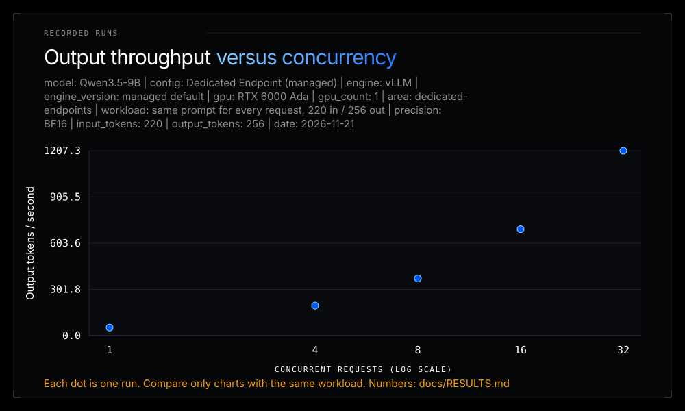

| Row | Concurrency | Output tok/s |
|---:|---:|---:|
| 59 | 1 | 52.7 |
| 60 | 4 | 196.3 |
| 61 | 8 | 373.3 |
| 62 | 16 | 695.1 |
| 63 | 32 | 1207.3 |

### Context 029

**Qwen3.5-9B** on **1x RTX A6000**, vLLM (managed default), 2026-11-20

**model**: Qwen3.5-9B | **config**: Dedicated Endpoint (managed) | **engine**: vLLM | **engine_version**: managed default | **gpu**: RTX A6000 | **gpu_count**: 1 | **area**: dedicated-endpoints | **workload**: same prompt for every request, 220 in / 256 out | **precision**: BF16 | **input_tokens**: 220 | **output_tokens**: 256 | **date**: 2026-11-20

| Row | Concurrency | Output tok/s |
|---:|---:|---:|
| 51 | 1 | 34.4 |
| 52 | 4 | 134.4 |
| 53 | 8 | 258.8 |

### Context 030

**Qwen3.5-9B** on **1x RTX PRO 6000**, vLLM (managed default), 2026-11-21

**model**: Qwen3.5-9B | **config**: Dedicated Endpoint (managed) | **engine**: vLLM | **engine_version**: managed default | **gpu**: RTX PRO 6000 | **gpu_count**: 1 | **area**: dedicated-endpoints | **workload**: same prompt for every request, 220 in / 256 out | **precision**: BF16 | **input_tokens**: 220 | **output_tokens**: 256 | **date**: 2026-11-21

| Row | Concurrency | Output tok/s |
|---:|---:|---:|
| 54 | 1 | 84.8 |
| 55 | 4 | 319.4 |
| 56 | 8 | 634.5 |
| 57 | 16 | 1167.5 |
| 58 | 32 | 1994.6 |

### Context 031

**Qwen3.6-35B-A3B** on **1x H200**, SGLang (managed default), 2026-11-21

**model**: Qwen3.6-35B-A3B | **config**: Dedicated Endpoint (managed) | **engine**: SGLang | **engine_version**: managed default | **gpu**: H200 | **gpu_count**: 1 | **area**: dedicated-endpoints | **workload**: same prompt for every request, 220 in / 256 out | **precision**: BF16 | **input_tokens**: 220 | **output_tokens**: 256 | **date**: 2026-11-21

| Row | Concurrency | Output tok/s |
|---:|---:|---:|
| 98 | 1 | 264.8 |
| 99 | 8 | 1839.5 |
| 100 | 16 | 3021.9 |
| 101 | 32 | 4910.7 |

### Context 032

**Qwen3.6-35B-A3B** on **1x H200**, vLLM (managed default), 2026-11-21

**model**: Qwen3.6-35B-A3B | **config**: Dedicated Endpoint (managed) | **engine**: vLLM | **engine_version**: managed default | **gpu**: H200 | **gpu_count**: 1 | **area**: dedicated-endpoints | **workload**: same prompt for every request, 220 in / 256 out | **precision**: BF16 | **input_tokens**: 220 | **output_tokens**: 256 | **date**: 2026-11-21

| Row | Concurrency | Output tok/s |
|---:|---:|---:|
| 89 | 1 | 247.5 |
| 90 | 4 | 744.1 |
| 91 | 8 | 1201.4 |
| 92 | 16 | 2834.5 |
| 93 | 32 | 3820 |

### Context 033

**Qwen3.6-35B-A3B-FP8** on **1x H100 SXM**, SGLang (managed default), 2026-11-21

**model**: Qwen3.6-35B-A3B-FP8 | **config**: Dedicated Endpoint (managed) | **engine**: SGLang | **engine_version**: managed default | **gpu**: H100 SXM | **gpu_count**: 1 | **area**: dedicated-endpoints | **workload**: same prompt for every request, 220 in / 256 out | **precision**: FP8 | **input_tokens**: 220 | **output_tokens**: 256 | **date**: 2026-11-21

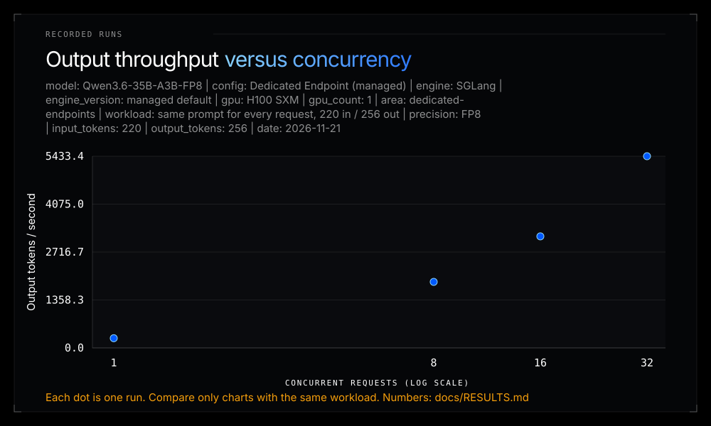

| Row | Concurrency | Output tok/s |
|---:|---:|---:|
| 94 | 1 | 274.6 |
| 95 | 8 | 1871 |
| 96 | 16 | 3161.4 |
| 97 | 32 | 5433.4 |

### Context 034

**Qwen3.6-35B-A3B-FP8** on **1x H100 SXM**, vLLM (managed default), 2026-11-21

**model**: Qwen3.6-35B-A3B-FP8 | **config**: Dedicated Endpoint (managed) | **engine**: vLLM | **engine_version**: managed default | **gpu**: H100 SXM | **gpu_count**: 1 | **area**: dedicated-endpoints | **workload**: same prompt for every request, 220 in / 256 out | **precision**: FP8 | **input_tokens**: 220 | **output_tokens**: 256 | **date**: 2026-11-21

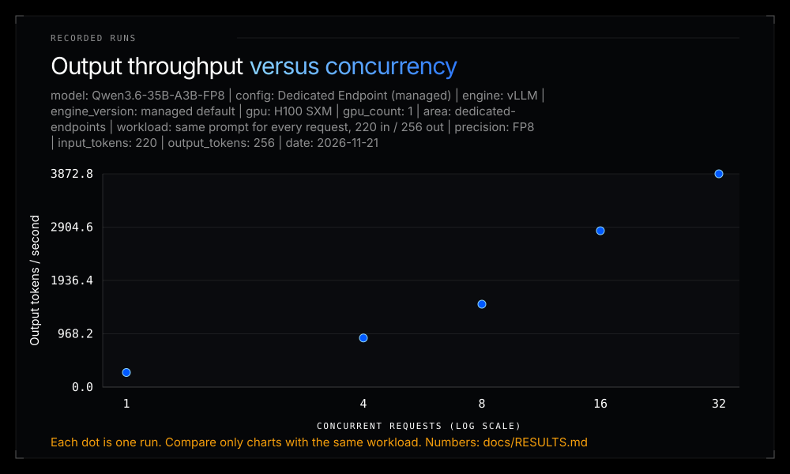

| Row | Concurrency | Output tok/s |
|---:|---:|---:|
| 107 | 1 | 265.3 |
| 108 | 4 | 892.2 |
| 109 | 8 | 1505.7 |
| 110 | 16 | 2838.9 |
| 111 | 32 | 3872.8 |

### Context 035

**Qwen3.6-35B-A3B-FP8** on **1x RTX 6000 Ada**, vLLM (managed default), 2026-11-21

**model**: Qwen3.6-35B-A3B-FP8 | **config**: Dedicated Endpoint (managed) | **engine**: vLLM | **engine_version**: managed default | **gpu**: RTX 6000 Ada | **gpu_count**: 1 | **area**: dedicated-endpoints | **workload**: same prompt for every request, 220 in / 256 out | **precision**: FP8 | **input_tokens**: 220 | **output_tokens**: 256 | **date**: 2026-11-21

| Row | Concurrency | Output tok/s |
|---:|---:|---:|
| 102 | 1 | 146.8 |
| 103 | 4 | 415.2 |
| 104 | 8 | 643.1 |
| 105 | 16 | 1075.8 |
| 106 | 32 | 1577.9 |

### Context 036

**Qwen3.6-35B-A3B-FP8** on **1x RTX A6000**, vLLM (managed default), 2026-11-21

**model**: Qwen3.6-35B-A3B-FP8 | **config**: Dedicated Endpoint (managed) | **engine**: vLLM | **engine_version**: managed default | **gpu**: RTX A6000 | **gpu_count**: 1 | **area**: dedicated-endpoints | **workload**: same prompt for every request, 220 in / 256 out | **precision**: FP8 | **input_tokens**: 220 | **output_tokens**: 256 | **date**: 2026-11-21

| Row | Concurrency | Output tok/s |
|---:|---:|---:|
| 79 | 1 | 124 |
| 80 | 4 | 357.5 |
| 81 | 8 | 614 |
| 82 | 16 | 972.9 |
| 83 | 32 | 1395.2 |

### Context 037

**Qwen3.6-35B-A3B-FP8** on **1x RTX PRO 6000**, vLLM (managed default), 2026-11-21

**model**: Qwen3.6-35B-A3B-FP8 | **config**: Dedicated Endpoint (managed) | **engine**: vLLM | **engine_version**: managed default | **gpu**: RTX PRO 6000 | **gpu_count**: 1 | **area**: dedicated-endpoints | **workload**: same prompt for every request, 220 in / 256 out | **precision**: FP8 | **input_tokens**: 220 | **output_tokens**: 256 | **date**: 2026-11-21

| Row | Concurrency | Output tok/s |
|---:|---:|---:|
| 84 | 1 | 201.6 |
| 85 | 4 | 617.4 |
| 86 | 8 | 987.5 |
| 87 | 16 | 1965.7 |
| 88 | 32 | 3243.4 |

### Context 038

**Qwen3.8-27B** on **1x H200**, SGLang (managed default), 2026-11-21

**model**: Qwen3.8-27B | **config**: Dedicated Endpoint (managed) | **engine**: SGLang | **engine_version**: managed default | **gpu**: H200 | **gpu_count**: 1 | **area**: dedicated-endpoints | **workload**: same prompt for every request, 220 in / 256 out | **precision**: BF16 | **input_tokens**: 220 | **output_tokens**: 256 | **date**: 2026-11-21

| Row | Concurrency | Output tok/s |
|---:|---:|---:|
| 184 | 1 | 68.1 |
| 185 | 8 | 498 |
| 186 | 16 | 930.5 |
| 187 | 32 | 1676.4 |

### Context 039

**Qwen3.8-27B** on **1x H200**, vLLM (managed default), 2026-11-21

**model**: Qwen3.8-27B | **config**: Dedicated Endpoint (managed) | **engine**: vLLM | **engine_version**: managed default | **gpu**: H200 | **gpu_count**: 1 | **area**: dedicated-endpoints | **workload**: same prompt for every request, 220 in / 256 out | **precision**: BF16 | **input_tokens**: 220 | **output_tokens**: 256 | **date**: 2026-11-21

| Row | Concurrency | Output tok/s |
|---:|---:|---:|
| 170 | 1 | 66.4 |
| 171 | 4 | 254.6 |
| 172 | 8 | 485.6 |
| 173 | 16 | 919.2 |
| 174 | 32 | 1646.2 |

### Context 040

**Qwen3.8-27B-FP8** on **1x H100 SXM**, SGLang (managed default), 2026-11-21

**model**: Qwen3.8-27B-FP8 | **config**: Dedicated Endpoint (managed) | **engine**: SGLang | **engine_version**: managed default | **gpu**: H100 SXM | **gpu_count**: 1 | **area**: dedicated-endpoints | **workload**: same prompt for every request, 220 in / 256 out | **precision**: FP8 | **input_tokens**: 220 | **output_tokens**: 256 | **date**: 2026-11-21

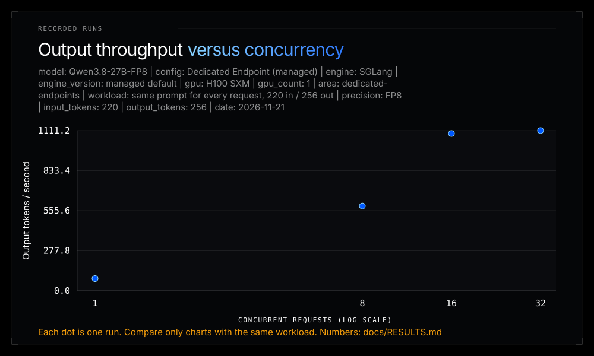

| Row | Concurrency | Output tok/s |
|---:|---:|---:|
| 180 | 1 | 84.3 |
| 181 | 8 | 587.6 |
| 182 | 16 | 1090.7 |
| 183 | 32 | 1111.2 |

### Context 041

**Qwen3.8-27B-FP8** on **1x B200**, vLLM (managed default), 2026-11-21

**model**: Qwen3.8-27B-FP8 | **config**: Dedicated Endpoint (managed) | **engine**: vLLM | **engine_version**: managed default | **gpu**: B200 | **gpu_count**: 1 | **area**: dedicated-endpoints | **workload**: same prompt for every request, 220 in / 256 out | **precision**: FP8 | **input_tokens**: 220 | **output_tokens**: 256 | **date**: 2026-11-21

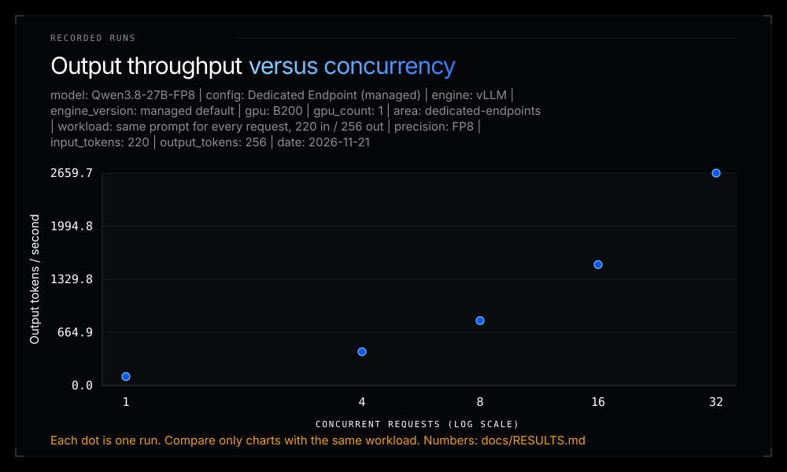

| Row | Concurrency | Output tok/s |
|---:|---:|---:|
| 175 | 1 | 111.6 |
| 176 | 4 | 422.4 |
| 177 | 8 | 811.7 |
| 178 | 16 | 1514 |
| 179 | 32 | 2659.7 |

### Context 042

**Qwen3.8-27B-FP8** on **1x H100 SXM**, vLLM (managed default), 2026-11-21

**model**: Qwen3.8-27B-FP8 | **config**: Dedicated Endpoint (managed) | **engine**: vLLM | **engine_version**: managed default | **gpu**: H100 SXM | **gpu_count**: 1 | **area**: dedicated-endpoints | **workload**: same prompt for every request, 220 in / 256 out | **precision**: FP8 | **input_tokens**: 220 | **output_tokens**: 256 | **date**: 2026-11-21

| Row | Concurrency | Output tok/s |
|---:|---:|---:|
| 188 | 1 | 80.7 |
| 189 | 4 | 302.5 |
| 190 | 8 | 575.4 |
| 191 | 16 | 1061.7 |
| 192 | 32 | 1830.7 |

### Context 043

**Qwen3.8-27B-FP8** on **1x H200**, vLLM (managed default), 2026-11-21

**model**: Qwen3.8-27B-FP8 | **config**: Dedicated Endpoint (managed) | **engine**: vLLM | **engine_version**: managed default | **gpu**: H200 | **gpu_count**: 1 | **area**: dedicated-endpoints | **workload**: same prompt for every request, 220 in / 256 out | **precision**: FP8 | **input_tokens**: 220 | **output_tokens**: 256 | **date**: 2026-11-21

| Row | Concurrency | Output tok/s |
|---:|---:|---:|
| 193 | 1 | 96 |
| 194 | 4 | 358 |
| 195 | 8 | 697.2 |
| 196 | 16 | 1294 |
| 197 | 32 | 2246.1 |

### Context 044

**Qwen3.8-27B-FP8** on **1x L40S**, vLLM (managed default), 2026-11-20

**model**: Qwen3.8-27B-FP8 | **config**: Dedicated Endpoint (managed) | **engine**: vLLM | **engine_version**: managed default | **gpu**: L40S | **gpu_count**: 1 | **area**: dedicated-endpoints | **workload**: same prompt for every request, 220 in / 256 out | **precision**: FP8 | **input_tokens**: 220 | **output_tokens**: 256 | **date**: 2026-11-20

| Row | Concurrency | Output tok/s |
|---:|---:|---:|
| 155 | 1 | 25.5 |
| 158 | 1 | 25.5 |
| 156 | 4 | 95 |
| 157 | 8 | 181.3 |
| 159 | 8 | 181.4 |

### Context 045

**Qwen3.8-27B-FP8** on **1x RTX 6000 Ada**, vLLM (managed default), 2026-11-21

**model**: Qwen3.8-27B-FP8 | **config**: Dedicated Endpoint (managed) | **engine**: vLLM | **engine_version**: managed default | **gpu**: RTX 6000 Ada | **gpu_count**: 1 | **area**: dedicated-endpoints | **workload**: same prompt for every request, 220 in / 256 out | **precision**: FP8 | **input_tokens**: 220 | **output_tokens**: 256 | **date**: 2026-11-21

| Row | Concurrency | Output tok/s |
|---:|---:|---:|
| 165 | 1 | 26.8 |
| 166 | 4 | 100 |
| 167 | 8 | 189.9 |
| 168 | 16 | 335.4 |
| 169 | 32 | 528.3 |

### Context 046

**Qwen3.8-27B-FP8** on **1x RTX PRO 6000**, vLLM (managed default), 2026-11-21

**model**: Qwen3.8-27B-FP8 | **config**: Dedicated Endpoint (managed) | **engine**: vLLM | **engine_version**: managed default | **gpu**: RTX PRO 6000 | **gpu_count**: 1 | **area**: dedicated-endpoints | **workload**: same prompt for every request, 220 in / 256 out | **precision**: FP8 | **input_tokens**: 220 | **output_tokens**: 256 | **date**: 2026-11-21

| Row | Concurrency | Output tok/s |
|---:|---:|---:|
| 160 | 1 | 45.6 |
| 161 | 4 | 170.9 |
| 162 | 8 | 332.7 |
| 163 | 16 | 609.7 |
| 164 | 32 | 1049.5 |

### Context 047

**gemma-4-26B-A4B-it** on **1x H100 SXM**, SGLang (managed default), 2026-11-21

**model**: gemma-4-26B-A4B-it | **config**: Dedicated Endpoint (managed) | **engine**: SGLang | **engine_version**: managed default | **gpu**: H100 SXM | **gpu_count**: 1 | **area**: dedicated-endpoints | **workload**: same prompt for every request, 220 in / 256 out | **precision**: BF16 | **input_tokens**: 220 | **output_tokens**: 256 | **date**: 2026-11-21

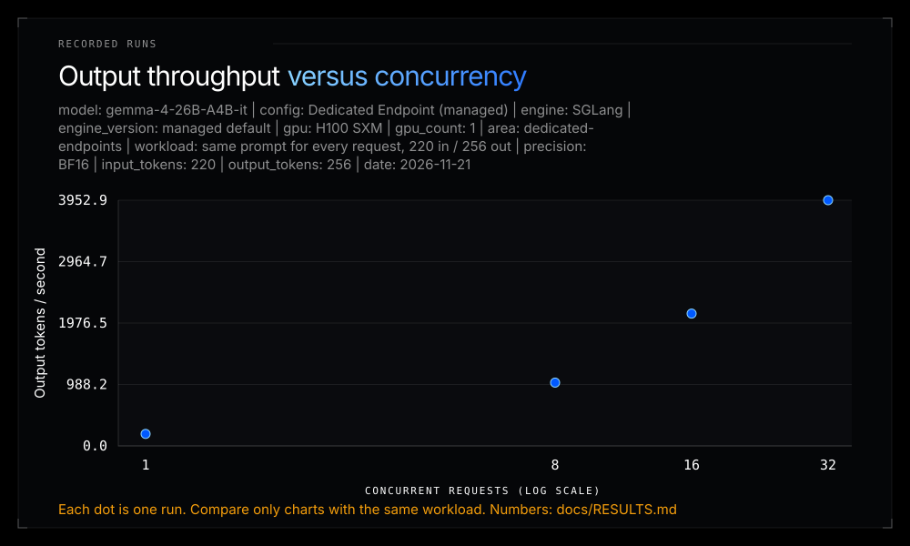

| Row | Concurrency | Output tok/s |
|---:|---:|---:|
| 229 | 1 | 192.8 |
| 230 | 8 | 1017.9 |
| 231 | 16 | 2128.4 |
| 232 | 32 | 3952.9 |

### Context 048

**gemma-4-26B-A4B-it** on **1x H100 SXM**, vLLM (managed default), 2026-11-21

**model**: gemma-4-26B-A4B-it | **config**: Dedicated Endpoint (managed) | **engine**: vLLM | **engine_version**: managed default | **gpu**: H100 SXM | **gpu_count**: 1 | **area**: dedicated-endpoints | **workload**: same prompt for every request, 220 in / 256 out | **precision**: BF16 | **input_tokens**: 220 | **output_tokens**: 256 | **date**: 2026-11-21

| Row | Concurrency | Output tok/s |
|---:|---:|---:|
| 224 | 1 | 201.3 |
| 225 | 4 | 565.7 |
| 226 | 8 | 1257.4 |
| 227 | 16 | 2430.7 |
| 228 | 32 | 3292.9 |

### Context 049

**gemma-4-26B-A4B-it** on **1x RTX PRO 6000**, vLLM (managed default), 2026-11-21

**model**: gemma-4-26B-A4B-it | **config**: Dedicated Endpoint (managed) | **engine**: vLLM | **engine_version**: managed default | **gpu**: RTX PRO 6000 | **gpu_count**: 1 | **area**: dedicated-endpoints | **workload**: same prompt for every request, 220 in / 256 out | **precision**: BF16 | **input_tokens**: 220 | **output_tokens**: 256 | **date**: 2026-11-21

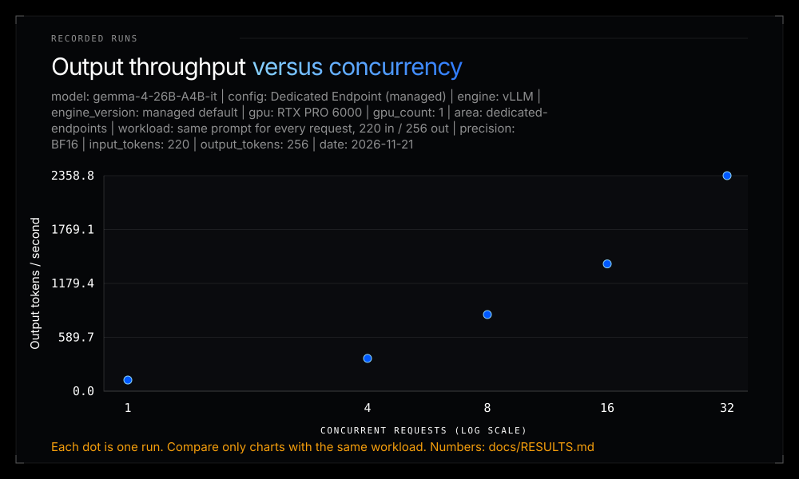

| Row | Concurrency | Output tok/s |
|---:|---:|---:|
| 219 | 1 | 122.1 |
| 220 | 4 | 358.9 |
| 221 | 8 | 838.6 |
| 222 | 16 | 1392.8 |
| 223 | 32 | 2358.8 |

## Multi-GPU tuning on B200 and B300

October 2026 tuning sweeps on B200 and B300, one to eight GPUs: tensor, data and expert parallelism, speculative decoding, KV cache and context options.

### Context 050

**GLM-5.3** on **8x B300**, SGLang (0.5.21), 2026-10-09

**model**: GLM-5.3 | **config**: DP-attention + EP8 + MTP | **engine**: SGLang | **engine_version**: 0.5.21 | **gpu**: B300 | **gpu_count**: 8 | **area**: multi-gpu-tuning | **workload**: closed loop, unique prompts, ~1k in / 512 out, 120 s per level | **precision**: NVFP4 (NVIDIA checkpoint) | **input_tokens**: 1032 | **output_tokens**: 512 | **date**: 2026-10-09

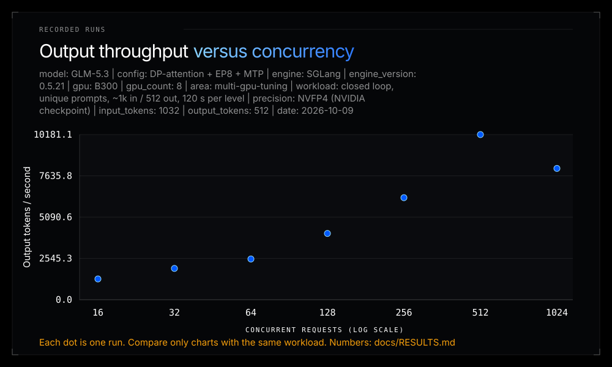

| Row | Concurrency | Output tok/s |
|---:|---:|---:|
| 423 | 16 | 1280.6 |
| 424 | 32 | 1929.2 |
| 425 | 64 | 2510.1 |
| 426 | 128 | 4085.2 |
| 427 | 256 | 6290.4 |
| 428 | 512 | 10181.1 |
| 429 | 1024 | 8093.8 |

### Context 051

**GLM-5.3** on **8x B300**, SGLang (0.5.21), 2026-10-09

**model**: GLM-5.3 | **config**: DP-attention + EP8 + MTP | **engine**: SGLang | **engine_version**: 0.5.21 | **gpu**: B300 | **gpu_count**: 8 | **area**: multi-gpu-tuning | **workload**: closed loop, unique prompts, ~7.7k in / 512 out, 120 s per level | **precision**: NVFP4 (NVIDIA checkpoint) | **input_tokens**: 7656 | **output_tokens**: 511 | **date**: 2026-10-09

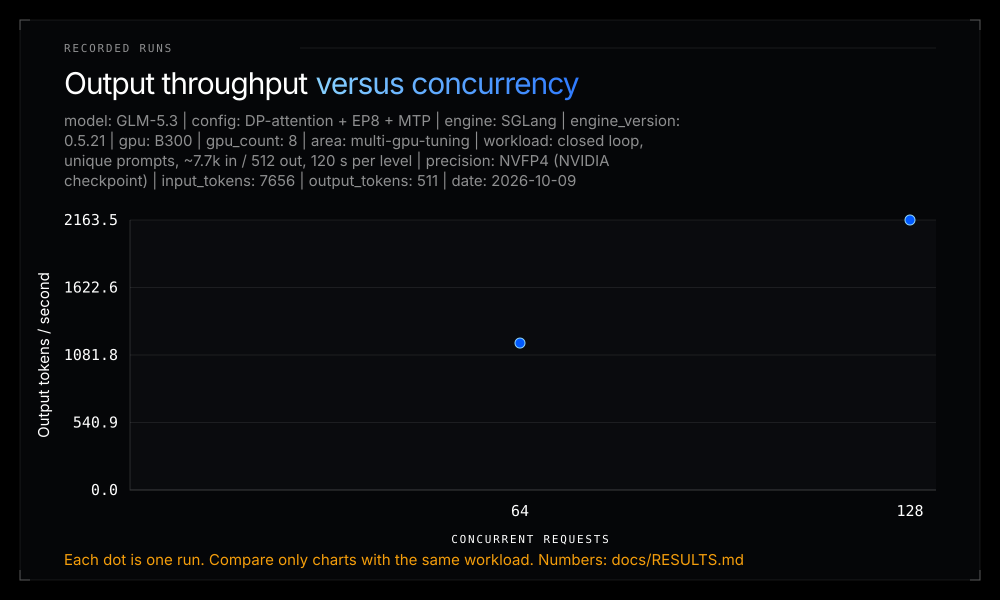

| Row | Concurrency | Output tok/s |
|---:|---:|---:|
| 432 | 64 | 1177.4 |
| 433 | 128 | 2163.5 |

### Context 052

**GLM-5.3** on **8x B300**, SGLang (0.5.21), 2026-10-09

**model**: GLM-5.3 | **config**: DP-attention + EP8 + MTP | **engine**: SGLang | **engine_version**: 0.5.21 | **gpu**: B300 | **gpu_count**: 8 | **area**: multi-gpu-tuning | **workload**: closed loop, unique prompts, ~7.7k in / 512 out, 120 s per level | **precision**: NVFP4 (NVIDIA checkpoint) | **input_tokens**: 7656 | **output_tokens**: 512 | **date**: 2026-10-09

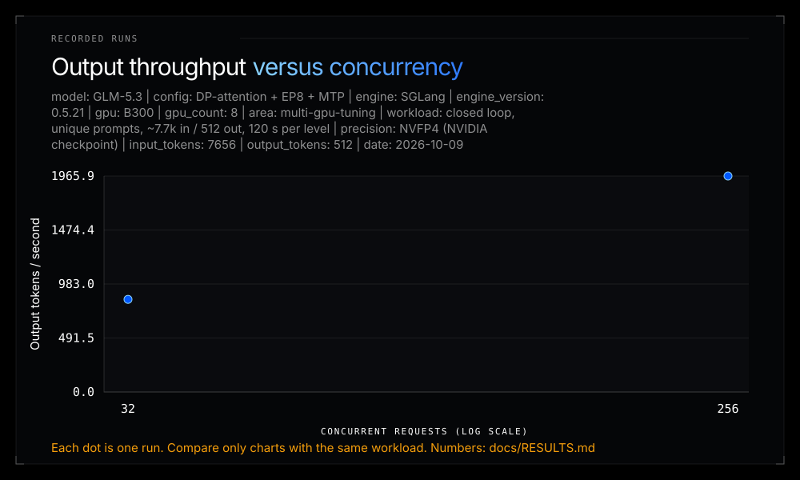

| Row | Concurrency | Output tok/s |
|---:|---:|---:|
| 431 | 32 | 843.2 |
| 434 | 256 | 1965.9 |

### Context 053

**GLM-5.3** on **4x B300**, SGLang (0.5.21), 2026-10-09

**model**: GLM-5.3 | **config**: TP4 + FP8 KV + hierarchical cache 200 GB | **engine**: SGLang | **engine_version**: 0.5.21 | **gpu**: B300 | **gpu_count**: 4 | **area**: multi-gpu-tuning | **workload**: closed loop, unique prompts, ~1k in / 512 out, 120 s per level | **precision**: NVFP4 (NVIDIA checkpoint) | **input_tokens**: 1032 | **output_tokens**: 512 | **date**: 2026-10-09

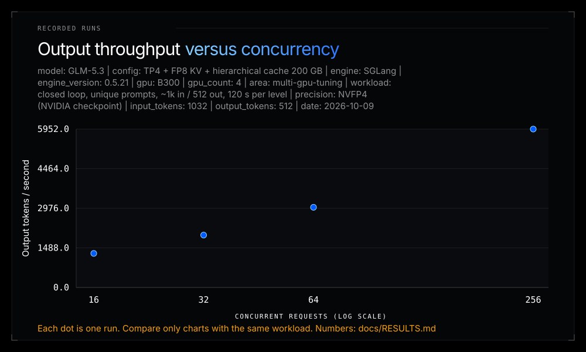

| Row | Concurrency | Output tok/s |
|---:|---:|---:|
| 457 | 16 | 1279.2 |
| 458 | 32 | 1967.6 |
| 459 | 64 | 3012.1 |
| 461 | 256 | 5952.0 |

### Context 054

**GLM-5.3** on **4x B300**, SGLang (0.5.21), 2026-10-09

**model**: GLM-5.3 | **config**: TP4 + FP8 KV + hierarchical cache 200 GB | **engine**: SGLang | **engine_version**: 0.5.21 | **gpu**: B300 | **gpu_count**: 4 | **area**: multi-gpu-tuning | **workload**: closed loop, unique prompts, ~7.7k in / 512 out, 120 s per level | **precision**: NVFP4 (NVIDIA checkpoint) | **input_tokens**: 7656 | **output_tokens**: 511 | **date**: 2026-10-09

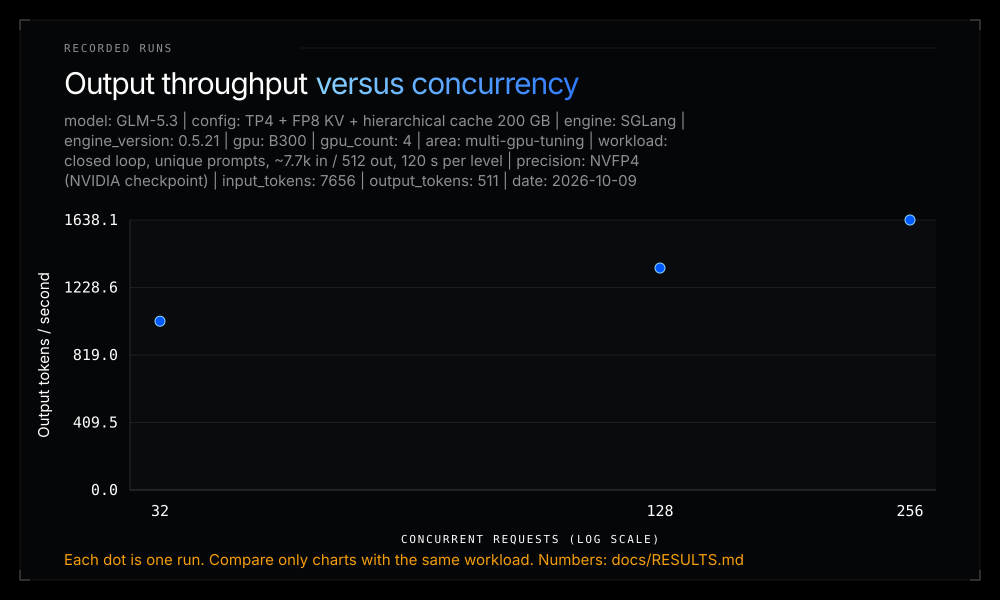

| Row | Concurrency | Output tok/s |
|---:|---:|---:|
| 463 | 32 | 1024.1 |
| 465 | 128 | 1346.7 |
| 466 | 256 | 1638.1 |

### Context 055

**GLM-5.3** on **4x B300**, SGLang (0.5.21), 2026-10-09

**model**: GLM-5.3 | **config**: TP4 + FP8 KV + hierarchical cache 200 GB | **engine**: SGLang | **engine_version**: 0.5.21 | **gpu**: B300 | **gpu_count**: 4 | **area**: multi-gpu-tuning | **workload**: closed loop, unique prompts, ~7.7k in / 512 out, 120 s per level | **precision**: NVFP4 (NVIDIA checkpoint) | **input_tokens**: 7656 | **output_tokens**: 512 | **date**: 2026-10-09

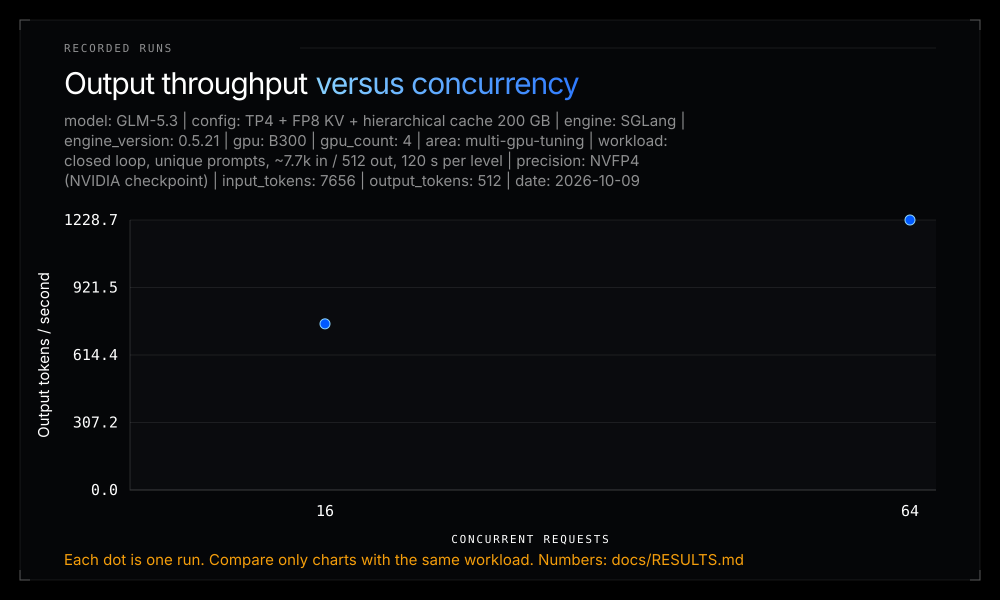

| Row | Concurrency | Output tok/s |
|---:|---:|---:|
| 462 | 16 | 756.1 |
| 464 | 64 | 1228.7 |

### Context 056

**GLM-5.3** on **4x B300**, SGLang (0.5.21), 2026-10-09

**model**: GLM-5.3 | **config**: TP4 + MTP (EAGLE 3/1/4) | **engine**: SGLang | **engine_version**: 0.5.21 | **gpu**: B300 | **gpu_count**: 4 | **area**: multi-gpu-tuning | **workload**: closed loop, unique prompts, ~1k in / 512 out, 120 s per level | **precision**: NVFP4 (NVIDIA checkpoint) | **input_tokens**: 1032 | **output_tokens**: 512 | **date**: 2026-10-09

| Row | Concurrency | Output tok/s |
|---:|---:|---:|
| 446 | 8 | 1163.5 |
| 448 | 32 | 2451.2 |
| 449 | 64 | 3242.5 |
| 450 | 128 | 4165.4 |
| 451 | 256 | 5134.2 |

### Context 057

**GLM-5.3** on **4x B300**, SGLang (0.5.21), 2026-10-09

**model**: GLM-5.3 | **config**: TP4 + MTP (EAGLE 3/1/4) | **engine**: SGLang | **engine_version**: 0.5.21 | **gpu**: B300 | **gpu_count**: 4 | **area**: multi-gpu-tuning | **workload**: closed loop, unique prompts, ~7.7k in / 512 out, 120 s per level | **precision**: NVFP4 (NVIDIA checkpoint) | **input_tokens**: 7656 | **output_tokens**: 512 | **date**: 2026-10-09

| Row | Concurrency | Output tok/s |
|---:|---:|---:|
| 452 | 8 | 772.6 |
| 453 | 16 | 980.1 |
| 454 | 32 | 1154.2 |
| 455 | 64 | 1550.9 |

### Context 058

**GLM-5.3** on **4x B300**, SGLang (0.5.21), 2026-10-09

**model**: GLM-5.3 | **config**: TP4 plain | **engine**: SGLang | **engine_version**: 0.5.21 | **gpu**: B300 | **gpu_count**: 4 | **area**: multi-gpu-tuning | **workload**: closed loop, unique prompts, ~1k in / 512 out, 120 s per level | **precision**: NVFP4 (NVIDIA checkpoint) | **input_tokens**: 1032 | **output_tokens**: 512 | **date**: 2026-10-09

| Row | Concurrency | Output tok/s |
|---:|---:|---:|
| 393 | 64 | 3039.0 |
| 394 | 128 | 4542.4 |
| 395 | 256 | 6038.4 |
| 396 | 512 | 7728.3 |

### Context 059

**GLM-5.3** on **8x B300**, SGLang (0.5.21), 2026-10-09

**model**: GLM-5.3 | **config**: TP8 + DP-attention + EP8 | **engine**: SGLang | **engine_version**: 0.5.21 | **gpu**: B300 | **gpu_count**: 8 | **area**: multi-gpu-tuning | **workload**: closed loop, unique prompts, ~1k in / 512 out, 120 s per level | **precision**: NVFP4 (NVIDIA checkpoint) | **input_tokens**: 1032 | **output_tokens**: 512 | **date**: 2026-10-09

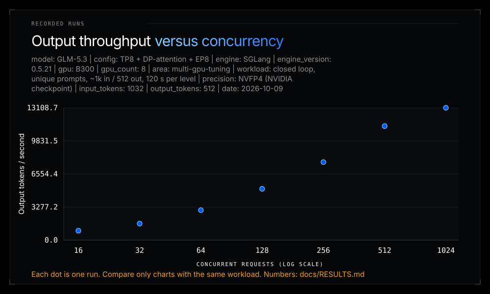

| Row | Concurrency | Output tok/s |
|---:|---:|---:|
| 400 | 16 | 928.2 |
| 401 | 32 | 1637.1 |
| 402 | 64 | 2968.8 |
| 403 | 128 | 5080.6 |
| 404 | 256 | 7725.9 |
| 405 | 512 | 11295.4 |
| 406 | 1024 | 13108.7 |

### Context 060

**GLM-5.3** on **8x B300**, SGLang (0.5.21), 2026-10-09

**model**: GLM-5.3 | **config**: TP8 + DP-attention + EP8 | **engine**: SGLang | **engine_version**: 0.5.21 | **gpu**: B300 | **gpu_count**: 8 | **area**: multi-gpu-tuning | **workload**: closed loop, unique prompts, ~7.7k in / 512 out, 120 s per level | **precision**: NVFP4 (NVIDIA checkpoint) | **input_tokens**: 7656 | **output_tokens**: 512 | **date**: 2026-10-09

| Row | Concurrency | Output tok/s |
|---:|---:|---:|
| 407 | 16 | 797.0 |
| 409 | 64 | 2047.3 |
| 410 | 128 | 3009.6 |
| 411 | 256 | 2986.8 |

### Context 061

**GLM-5.3** on **8x B300**, SGLang (0.5.21), 2026-10-09

**model**: GLM-5.3 | **config**: TP8 + MTP (EAGLE 3/1/4) | **engine**: SGLang | **engine_version**: 0.5.21 | **gpu**: B300 | **gpu_count**: 8 | **area**: multi-gpu-tuning | **workload**: closed loop, unique prompts, ~1k in / 512 out, 120 s per level | **precision**: NVFP4 (NVIDIA checkpoint) | **input_tokens**: 1032 | **output_tokens**: 512 | **date**: 2026-10-09

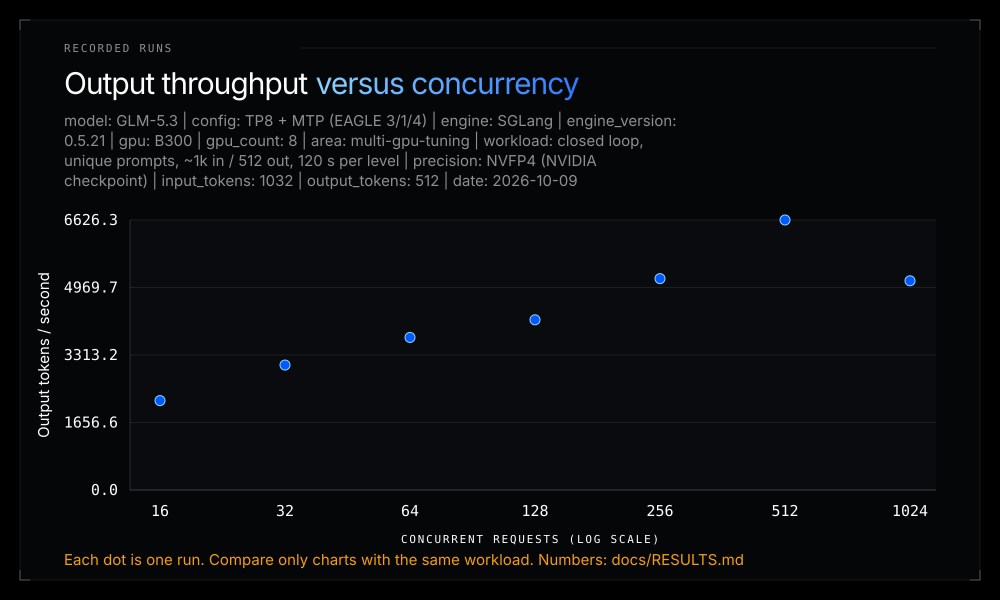

| Row | Concurrency | Output tok/s |
|---:|---:|---:|
| 435 | 16 | 2193.5 |
| 436 | 32 | 3066.6 |
| 437 | 64 | 3744.0 |
| 438 | 128 | 4176.5 |
| 439 | 256 | 5187.4 |
| 440 | 512 | 6626.3 |
| 441 | 1024 | 5134.4 |

### Context 062

**GLM-5.3** on **8x B300**, SGLang (0.5.21), 2026-10-09

**model**: GLM-5.3 | **config**: TP8 + MTP (EAGLE 3/1/4) | **engine**: SGLang | **engine_version**: 0.5.21 | **gpu**: B300 | **gpu_count**: 8 | **area**: multi-gpu-tuning | **workload**: closed loop, unique prompts, ~7.7k in / 512 out, 120 s per level | **precision**: NVFP4 (NVIDIA checkpoint) | **input_tokens**: 7656 | **output_tokens**: 512 | **date**: 2026-10-09

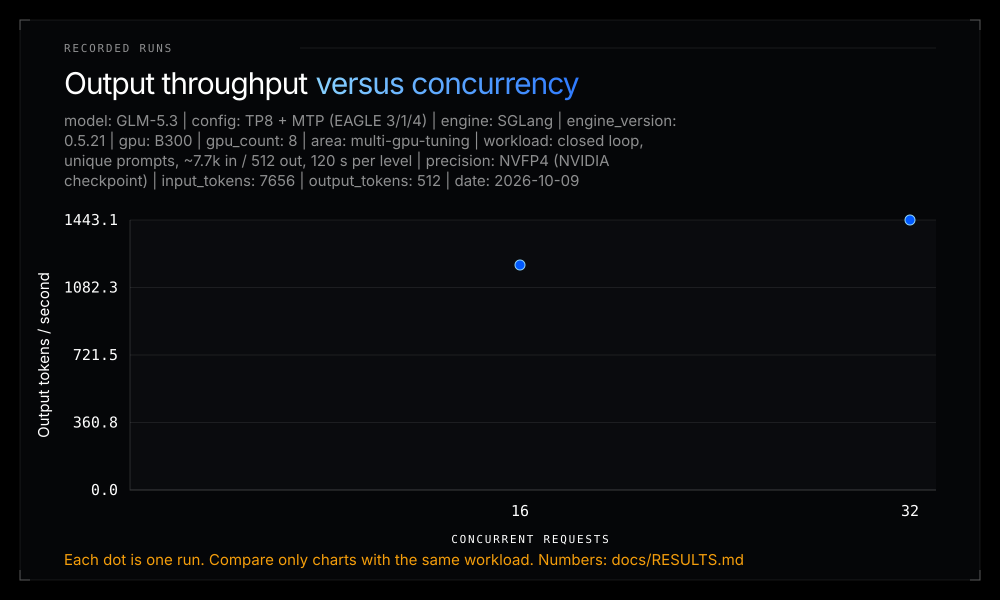

| Row | Concurrency | Output tok/s |
|---:|---:|---:|
| 442 | 16 | 1202.6 |
| 443 | 32 | 1443.1 |

### Context 063

**GLM-5.3** on **8x B300**, SGLang (0.5.21), 2026-10-09

**model**: GLM-5.3 | **config**: TP8 plain | **engine**: SGLang | **engine_version**: 0.5.21 | **gpu**: B300 | **gpu_count**: 8 | **area**: multi-gpu-tuning | **workload**: closed loop, unique prompts, ~1k in / 512 out, 120 s per level | **precision**: NVFP4 (NVIDIA checkpoint) | **input_tokens**: 1032 | **output_tokens**: 512 | **date**: 2026-10-09

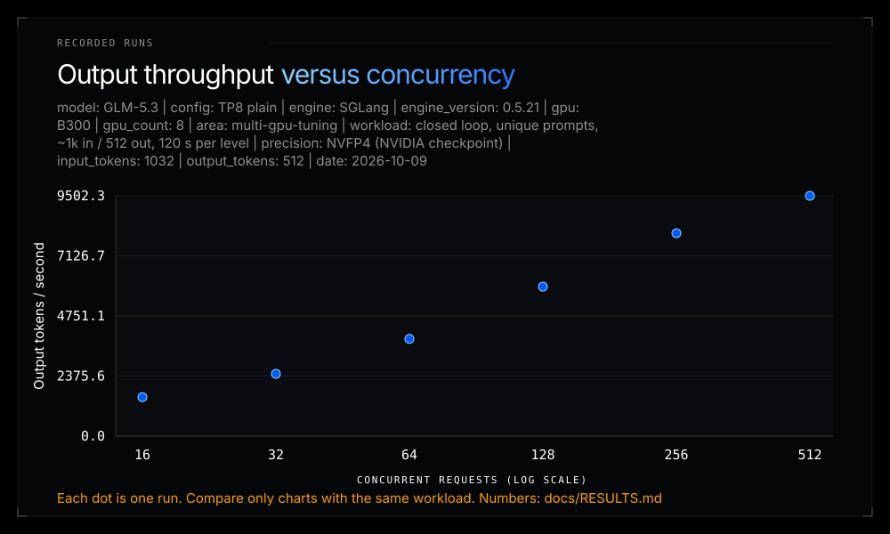

| Row | Concurrency | Output tok/s |
|---:|---:|---:|
| 412 | 16 | 1540.0 |
| 413 | 32 | 2463.2 |
| 414 | 64 | 3844.2 |
| 415 | 128 | 5908.9 |
| 416 | 256 | 8022.4 |
| 417 | 512 | 9502.3 |

### Context 064

**GLM-5.3** on **8x B300**, SGLang (0.5.21), 2026-10-09

**model**: GLM-5.3 | **config**: TP8 plain | **engine**: SGLang | **engine_version**: 0.5.21 | **gpu**: B300 | **gpu_count**: 8 | **area**: multi-gpu-tuning | **workload**: closed loop, unique prompts, ~7.7k in / 512 out, 120 s per level | **precision**: NVFP4 (NVIDIA checkpoint) | **input_tokens**: 7656 | **output_tokens**: 512 | **date**: 2026-10-09

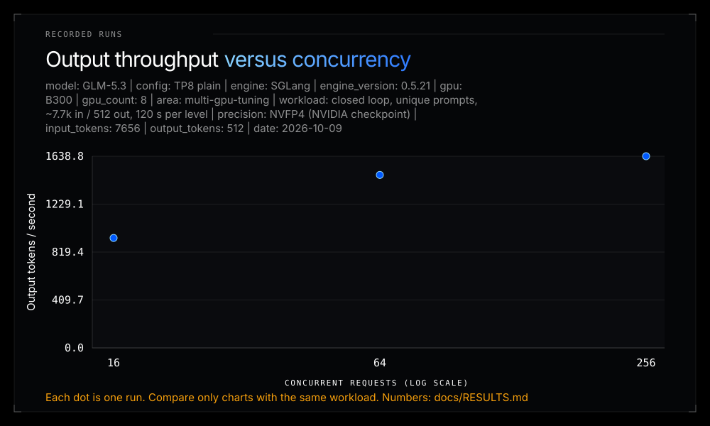

| Row | Concurrency | Output tok/s |
|---:|---:|---:|
| 418 | 16 | 939.8 |
| 420 | 64 | 1478.8 |
| 422 | 256 | 1638.8 |

### Context 065

**Kimi-K2.7-Code** on **8x B300**, vLLM (0.31.0), 2026-10-09

**model**: Kimi-K2.7-Code | **config**: DP8 + expert parallel | **engine**: vLLM | **engine_version**: 0.31.0 | **gpu**: B300 | **gpu_count**: 8 | **area**: multi-gpu-tuning | **workload**: closed loop, unique prompts, ~1k in / 512 out, 120 s per level | **precision**: NVFP4 (NVIDIA checkpoint) | **input_tokens**: 989 | **output_tokens**: 512 | **date**: 2026-10-09

| Row | Concurrency | Output tok/s |
|---:|---:|---:|
| 310 | 16 | 832.5 |
| 311 | 32 | 1612.0 |
| 312 | 64 | 2757.1 |
| 313 | 128 | 5556.4 |
| 314 | 256 | 8483.9 |
| 315 | 512 | 13170.6 |
| 316 | 1024 | 22419.2 |

### Context 066

**Kimi-K2.7-Code** on **8x B300**, vLLM (0.31.0), 2026-10-09

**model**: Kimi-K2.7-Code | **config**: DP8 + expert parallel | **engine**: vLLM | **engine_version**: 0.31.0 | **gpu**: B300 | **gpu_count**: 8 | **area**: multi-gpu-tuning | **workload**: closed loop, unique prompts, ~7.7k in / 512 out, 120 s per level | **precision**: NVFP4 (NVIDIA checkpoint) | **input_tokens**: 7367 | **output_tokens**: 512 | **date**: 2026-10-09

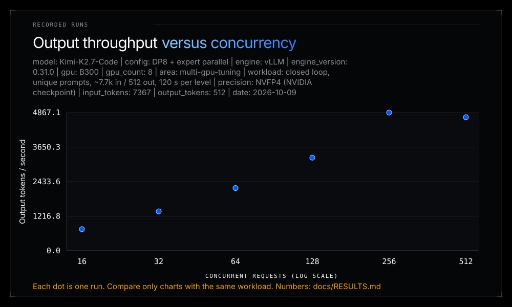

| Row | Concurrency | Output tok/s |
|---:|---:|---:|
| 317 | 16 | 759.7 |
| 318 | 32 | 1386.1 |
| 319 | 64 | 2207.2 |
| 320 | 128 | 3278.0 |
| 321 | 256 | 4867.1 |
| 322 | 512 | 4704.5 |

### Context 067

**Kimi-K2.7-Code** on **4x B300**, vLLM (0.31.0), 2026-10-09

**model**: Kimi-K2.7-Code | **config**: TP4 + FP8 KV | **engine**: vLLM | **engine_version**: 0.31.0 | **gpu**: B300 | **gpu_count**: 4 | **area**: multi-gpu-tuning | **workload**: closed loop, unique prompts, ~1k in / 512 out, 120 s per level | **precision**: NVFP4 (NVIDIA checkpoint) | **input_tokens**: 989 | **output_tokens**: 512 | **date**: 2026-10-09

| Row | Concurrency | Output tok/s |
|---:|---:|---:|
| 351 | 16 | 1384.4 |
| 352 | 32 | 2186.8 |
| 353 | 64 | 3278.2 |
| 354 | 128 | 5066.8 |
| 355 | 256 | 7317.3 |

### Context 068

**Kimi-K2.7-Code** on **4x B300**, vLLM (0.31.0), 2026-10-09

**model**: Kimi-K2.7-Code | **config**: TP4 + FP8 KV | **engine**: vLLM | **engine_version**: 0.31.0 | **gpu**: B300 | **gpu_count**: 4 | **area**: multi-gpu-tuning | **workload**: closed loop, unique prompts, ~7.7k in / 512 out, 120 s per level | **precision**: NVFP4 (NVIDIA checkpoint) | **input_tokens**: 7367 | **output_tokens**: 512 | **date**: 2026-10-09

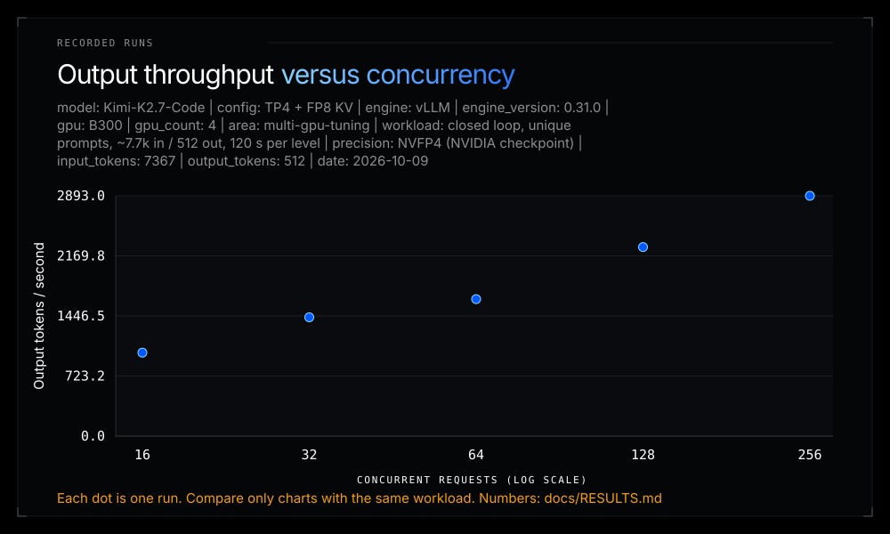

| Row | Concurrency | Output tok/s |
|---:|---:|---:|
| 356 | 16 | 1004.6 |
| 357 | 32 | 1430.1 |
| 358 | 64 | 1649.2 |
| 359 | 128 | 2275.6 |
| 360 | 256 | 2893.0 |

### Context 069

**Kimi-K2.7-Code** on **4x B300**, vLLM (0.31.0), 2026-10-09

**model**: Kimi-K2.7-Code | **config**: TP4 + n-gram speculation | **engine**: vLLM | **engine_version**: 0.31.0 | **gpu**: B300 | **gpu_count**: 4 | **area**: multi-gpu-tuning | **workload**: closed loop, unique prompts, ~1k in / 512 out, 120 s per level | **precision**: NVFP4 (NVIDIA checkpoint) | **input_tokens**: 989 | **output_tokens**: 512 | **date**: 2026-10-09

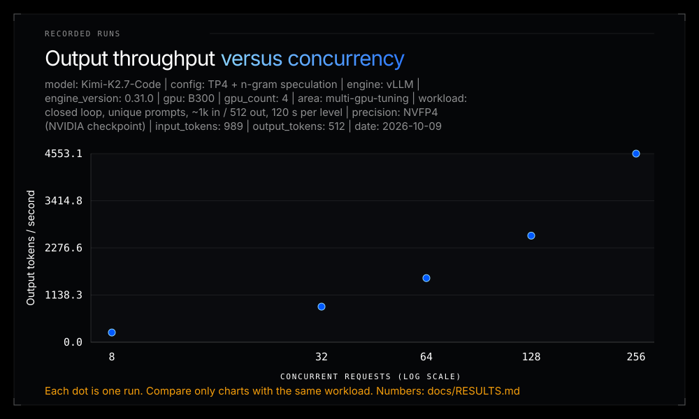

| Row | Concurrency | Output tok/s |
|---:|---:|---:|
| 339 | 8 | 234.1 |
| 341 | 32 | 858.5 |
| 342 | 64 | 1547.8 |
| 343 | 128 | 2572.6 |
| 344 | 256 | 4553.1 |

### Context 070

**Kimi-K2.7-Code** on **4x B300**, vLLM (0.31.0), 2026-10-09

**model**: Kimi-K2.7-Code | **config**: TP4 + n-gram speculation | **engine**: vLLM | **engine_version**: 0.31.0 | **gpu**: B300 | **gpu_count**: 4 | **area**: multi-gpu-tuning | **workload**: closed loop, unique prompts, ~7.7k in / 512 out, 120 s per level | **precision**: NVFP4 (NVIDIA checkpoint) | **input_tokens**: 7367 | **output_tokens**: 512 | **date**: 2026-10-09

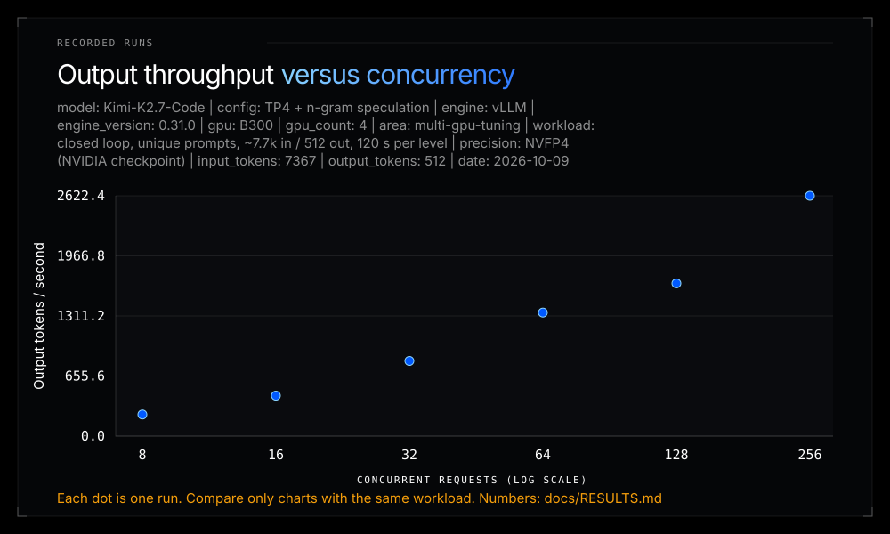

| Row | Concurrency | Output tok/s |
|---:|---:|---:|
| 345 | 8 | 235.6 |
| 346 | 16 | 441.3 |
| 347 | 32 | 820.5 |
| 348 | 64 | 1348.1 |
| 349 | 128 | 1666.6 |
| 350 | 256 | 2622.4 |

### Context 071

**Kimi-K2.7-Code** on **4x B300**, vLLM (0.31.0), 2026-10-09

**model**: Kimi-K2.7-Code | **config**: TP4 plain | **engine**: vLLM | **engine_version**: 0.31.0 | **gpu**: B300 | **gpu_count**: 4 | **area**: multi-gpu-tuning | **workload**: closed loop, unique prompts, ~1k in / 512 out, 120 s per level | **precision**: NVFP4 (NVIDIA checkpoint) | **input_tokens**: 989 | **output_tokens**: 512 | **date**: 2026-10-09

| Row | Concurrency | Output tok/s |
|---:|---:|---:|
| 302 | 64 | 3297.6 |
| 303 | 128 | 4948.9 |
| 304 | 256 | 7179.3 |
| 305 | 512 | 9637.9 |

### Context 072

**Kimi-K2.7-Code** on **4x B300**, vLLM (0.31.0), 2026-10-09

**model**: Kimi-K2.7-Code | **config**: TP4 plain | **engine**: vLLM | **engine_version**: 0.31.0 | **gpu**: B300 | **gpu_count**: 4 | **area**: multi-gpu-tuning | **workload**: closed loop, unique prompts, ~7.7k in / 512 out, 120 s per level | **precision**: NVFP4 (NVIDIA checkpoint) | **input_tokens**: 7367 | **output_tokens**: 512 | **date**: 2026-10-09

| Row | Concurrency | Output tok/s |
|---:|---:|---:|
| 306 | 64 | 1649.2 |
| 307 | 128 | 2290.0 |
| 308 | 256 | 2894.0 |
| 309 | 512 | 2397.8 |

### Context 073

**Kimi-K2.7-Code** on **8x B300**, vLLM (0.31.0), 2026-10-09

**model**: Kimi-K2.7-Code | **config**: TP4 x DP2 + expert parallel | **engine**: vLLM | **engine_version**: 0.31.0 | **gpu**: B300 | **gpu_count**: 8 | **area**: multi-gpu-tuning | **workload**: closed loop, unique prompts, ~1k in / 512 out, 120 s per level | **precision**: NVFP4 (NVIDIA checkpoint) | **input_tokens**: 989 | **output_tokens**: 512 | **date**: 2026-10-09

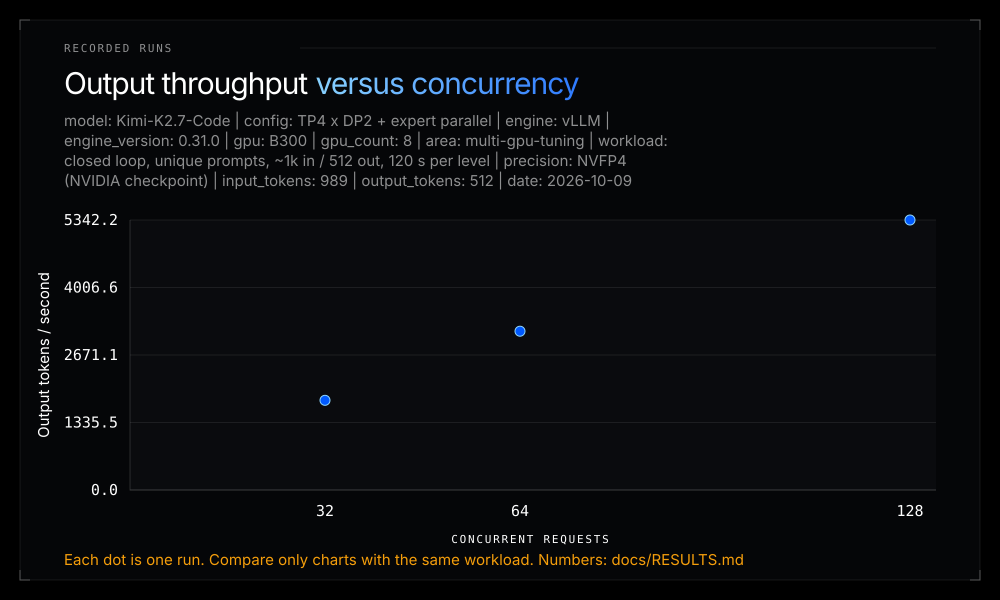

| Row | Concurrency | Output tok/s |
|---:|---:|---:|
| 336 | 32 | 1774.4 |
| 337 | 64 | 3141.6 |
| 338 | 128 | 5342.2 |

### Context 074

**Kimi-K2.7-Code** on **8x B300**, vLLM (0.31.0), 2026-10-09

**model**: Kimi-K2.7-Code | **config**: TP8 plain | **engine**: vLLM | **engine_version**: 0.31.0 | **gpu**: B300 | **gpu_count**: 8 | **area**: multi-gpu-tuning | **workload**: closed loop, unique prompts, ~1k in / 512 out, 120 s per level | **precision**: NVFP4 (NVIDIA checkpoint) | **input_tokens**: 989 | **output_tokens**: 512 | **date**: 2026-10-09

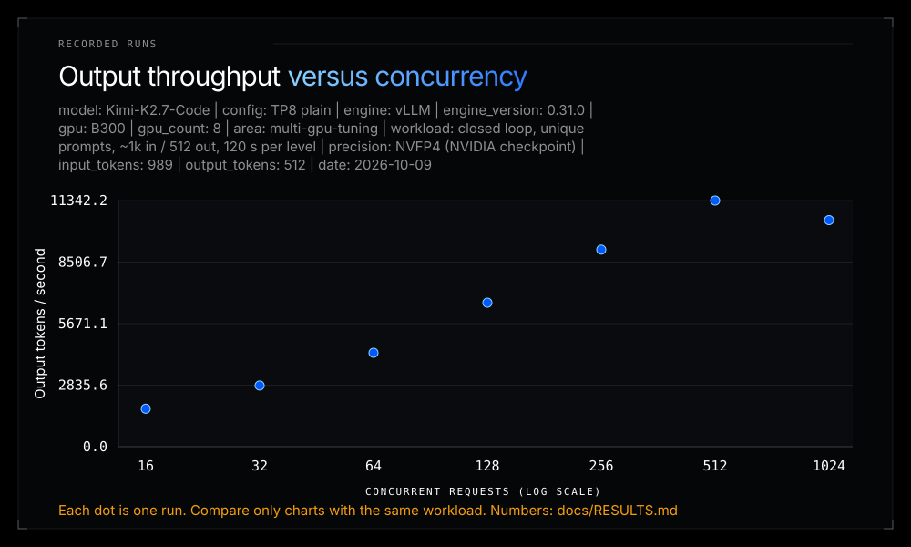

| Row | Concurrency | Output tok/s |
|---:|---:|---:|
| 323 | 16 | 1749.8 |
| 324 | 32 | 2819.2 |
| 325 | 64 | 4326.3 |
| 326 | 128 | 6635.3 |
| 327 | 256 | 9080.9 |
| 328 | 512 | 11342.2 |
| 329 | 1024 | 10438.9 |

### Context 075

**Kimi-K2.7-Code** on **8x B300**, vLLM (0.31.0), 2026-10-09

**model**: Kimi-K2.7-Code | **config**: TP8 plain | **engine**: vLLM | **engine_version**: 0.31.0 | **gpu**: B300 | **gpu_count**: 8 | **area**: multi-gpu-tuning | **workload**: closed loop, unique prompts, ~7.7k in / 512 out, 120 s per level | **precision**: NVFP4 (NVIDIA checkpoint) | **input_tokens**: 7367 | **output_tokens**: 512 | **date**: 2026-10-09

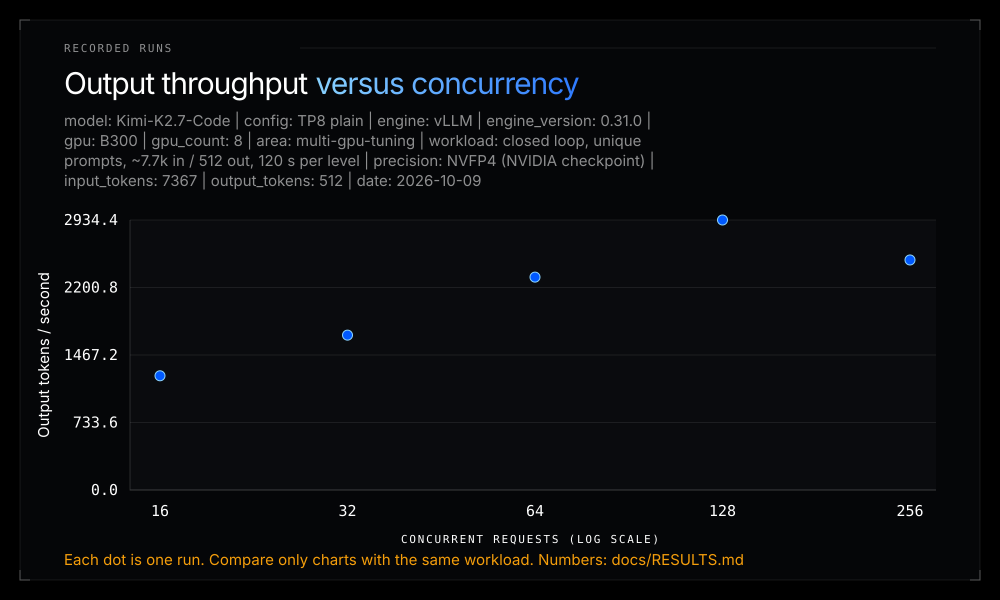

| Row | Concurrency | Output tok/s |
|---:|---:|---:|
| 330 | 16 | 1241.3 |
| 331 | 32 | 1683.0 |
| 332 | 64 | 2313.6 |
| 333 | 128 | 2934.4 |
| 334 | 256 | 2500.0 |

### Context 076

**Qwen3.8-27B** on **1x B200**, SGLang (0.5.21), 2026-10-08

**model**: Qwen3.8-27B | **config**: not recorded | **engine**: SGLang | **engine_version**: 0.5.21 | **gpu**: B200 | **gpu_count**: 1 | **area**: multi-gpu-tuning | **workload**: closed loop, unique random prompts (0% prefix cache), ~1k in / 512 out, thinking off, 180 s per level (40 s warm-up) | **precision**: NVFP4 MLP + FP8 attention, FP8 KV | **input_tokens**: 1040 | **output_tokens**: 512 | **date**: 2026-10-08

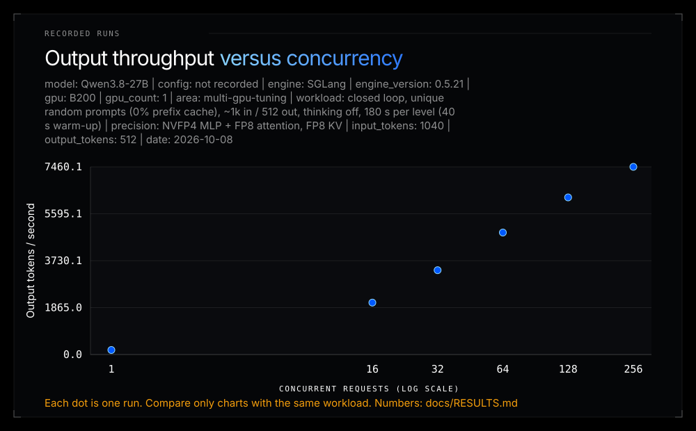

| Row | Concurrency | Output tok/s |
|---:|---:|---:|
| 123 | 1 | 180.4 |
| 124 | 16 | 2063.8 |
| 125 | 32 | 3352.2 |
| 126 | 64 | 4848.6 |
| 127 | 128 | 6244.6 |
| 128 | 256 | 7460.1 |

### Context 077

**Qwen3.8-27B** on **1x B200**, SGLang (0.5.21), 2026-10-08

**model**: Qwen3.8-27B | **config**: not recorded | **engine**: SGLang | **engine_version**: 0.5.21 | **gpu**: B200 | **gpu_count**: 1 | **area**: multi-gpu-tuning | **workload**: closed loop, unique random prompts (0% prefix cache), ~7.8k in / 512 out, thinking off, 180 s per level (40 s warm-up) | **precision**: NVFP4 MLP + FP8 attention, FP8 KV | **input_tokens**: 7664 | **output_tokens**: 512 | **date**: 2026-10-08

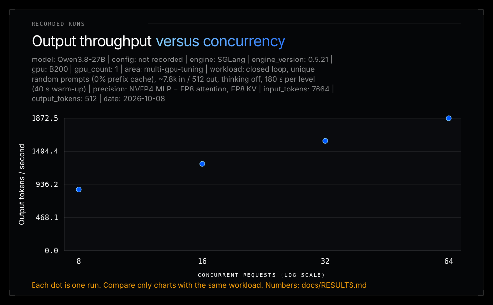

| Row | Concurrency | Output tok/s |
|---:|---:|---:|
| 130 | 8 | 863.0 |
| 131 | 16 | 1226.1 |
| 132 | 32 | 1551.7 |
| 133 | 64 | 1872.5 |

### Context 078

**Qwen3.8-27B** on **1x B200**, SGLang + MTP (0.5.21), 2026-10-08

**model**: Qwen3.8-27B | **config**: not recorded | **engine**: SGLang + MTP | **engine_version**: 0.5.21 | **gpu**: B200 | **gpu_count**: 1 | **area**: multi-gpu-tuning | **workload**: closed loop, unique prompts, ~1k in / 512 out, thinking off, temperature 0.7, MTP 3 draft tokens | **precision**: NVFP4 MLP + FP8 attention, FP8 KV | **input_tokens**: 1040 | **output_tokens**: 512 | **date**: 2026-10-08

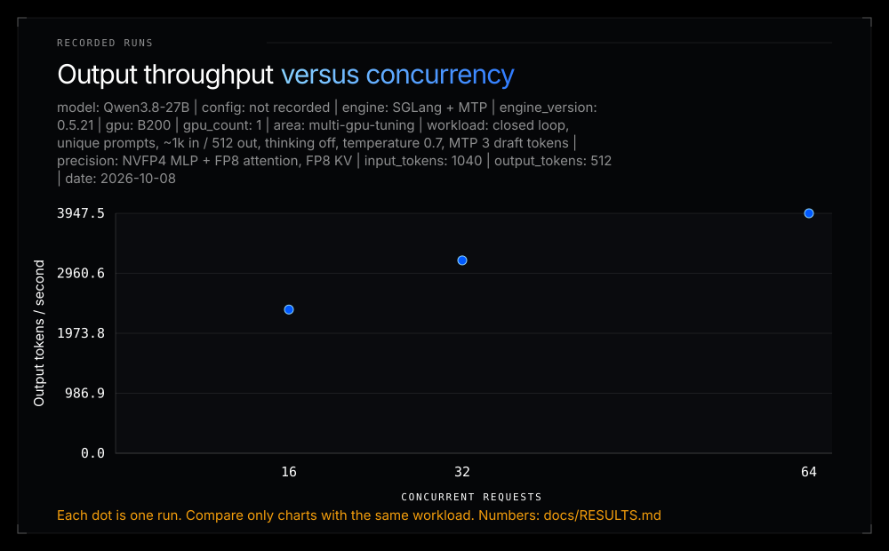

| Row | Concurrency | Output tok/s |
|---:|---:|---:|
| 142 | 16 | 2364.1 |
| 143 | 32 | 3173.3 |
| 144 | 64 | 3947.5 |

### Context 079

**Qwen3.8-27B** on **1x B200**, SGLang + MTP (0.5.21), 2026-10-08

**model**: Qwen3.8-27B | **config**: not recorded | **engine**: SGLang + MTP | **engine_version**: 0.5.21 | **gpu**: B200 | **gpu_count**: 1 | **area**: multi-gpu-tuning | **workload**: closed loop, unique prompts, ~7.8k in / 512 out, thinking off, temperature 0.7, MTP 3 draft tokens | **precision**: NVFP4 MLP + FP8 attention, FP8 KV | **input_tokens**: 7664 | **output_tokens**: 512 | **date**: 2026-10-08

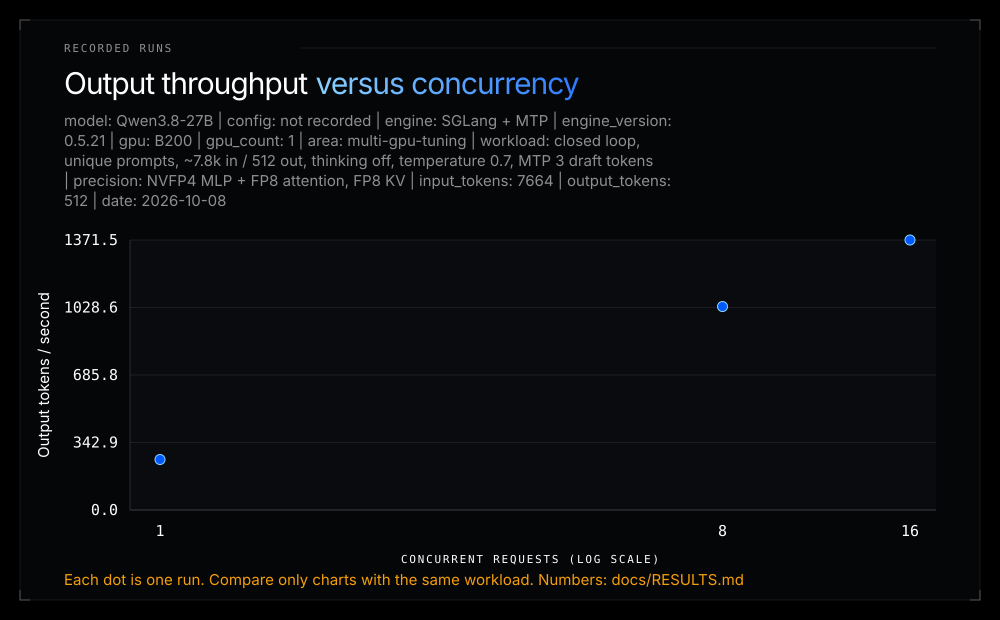

| Row | Concurrency | Output tok/s |
|---:|---:|---:|
| 145 | 1 | 256.4 |
| 146 | 8 | 1033.5 |
| 147 | 16 | 1371.5 |

### Context 080

**Qwen3.8-27B** on **1x B200**, vLLM (0.31.0), 2026-10-08

**model**: Qwen3.8-27B | **config**: not recorded | **engine**: vLLM | **engine_version**: 0.31.0 | **gpu**: B200 | **gpu_count**: 1 | **area**: multi-gpu-tuning | **workload**: closed loop, unique random prompts (0% prefix cache), ~1k in / 512 out, thinking off, 180 s per level (40 s warm-up) | **precision**: NVFP4 MLP + FP8 attention, FP8 KV | **input_tokens**: 1040 | **output_tokens**: 512 | **date**: 2026-10-08

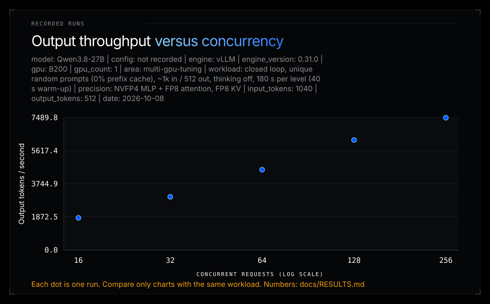

| Row | Concurrency | Output tok/s |
|---:|---:|---:|
| 113 | 16 | 1821.4 |
| 114 | 32 | 3014.9 |
| 115 | 64 | 4545.3 |
| 116 | 128 | 6227.1 |
| 117 | 256 | 7489.8 |

### Context 081

**Qwen3.8-27B** on **1x B200**, vLLM (0.31.0), 2026-10-08

**model**: Qwen3.8-27B | **config**: not recorded | **engine**: vLLM | **engine_version**: 0.31.0 | **gpu**: B200 | **gpu_count**: 1 | **area**: multi-gpu-tuning | **workload**: closed loop, unique random prompts (0% prefix cache), ~7.8k in / 512 out, thinking off, 180 s per level (40 s warm-up) | **precision**: NVFP4 MLP + FP8 attention, FP8 KV | **input_tokens**: 7664 | **output_tokens**: 512 | **date**: 2026-10-08

| Row | Concurrency | Output tok/s |
|---:|---:|---:|
| 118 | 1 | 145.3 |
| 119 | 8 | 799.1 |
| 120 | 16 | 1189.1 |
| 121 | 32 | 1581.7 |
| 122 | 64 | 1909.9 |

### Context 082

**Qwen3.8-27B** on **1x B200**, vLLM + MTP (0.31.0), 2026-10-08

**model**: Qwen3.8-27B | **config**: not recorded | **engine**: vLLM + MTP | **engine_version**: 0.31.0 | **gpu**: B200 | **gpu_count**: 1 | **area**: multi-gpu-tuning | **workload**: closed loop, unique prompts, ~1k in / 512 out, thinking off, temperature 0.7, MTP 3 draft tokens | **precision**: NVFP4 MLP + FP8 attention, FP8 KV | **input_tokens**: 1040 | **output_tokens**: 512 | **date**: 2026-10-08

| Row | Concurrency | Output tok/s |
|---:|---:|---:|
| 134 | 1 | 265.8 |
| 135 | 16 | 1779.5 |
| 136 | 32 | 2396.9 |
| 137 | 64 | 3407.2 |

### Context 083

**Qwen3.8-27B** on **1x B200**, vLLM + MTP (0.31.0), 2026-10-08

**model**: Qwen3.8-27B | **config**: not recorded | **engine**: vLLM + MTP | **engine_version**: 0.31.0 | **gpu**: B200 | **gpu_count**: 1 | **area**: multi-gpu-tuning | **workload**: closed loop, unique prompts, ~7.8k in / 512 out, thinking off, temperature 0.7, MTP 3 draft tokens | **precision**: NVFP4 MLP + FP8 attention, FP8 KV | **input_tokens**: 7664 | **output_tokens**: 512 | **date**: 2026-10-08

| Row | Concurrency | Output tok/s |
|---:|---:|---:|
| 138 | 1 | 232.8 |
| 139 | 8 | 956.6 |
| 140 | 16 | 1239.4 |

## Large-model validation on B300

October 2026 validation sweeps of large mixture-of-experts models on 4x B300.

### Context 084

**DeepSeek-V4.1-Flash** on **4x B300**, SGLang (version not recorded), 2026-10-21

**model**: DeepSeek-V4.1-Flash | **config**: TP4, tuned settings | **engine**: SGLang | **engine_version**: not recorded | **gpu**: B300 | **gpu_count**: 4 | **area**: large-model-validation | **workload**: validation sweep, streaming, prompt about 5900 words | **precision**: not recorded | **input_tokens**: not recorded | **output_tokens**: not recorded | **date**: 2026-10-21

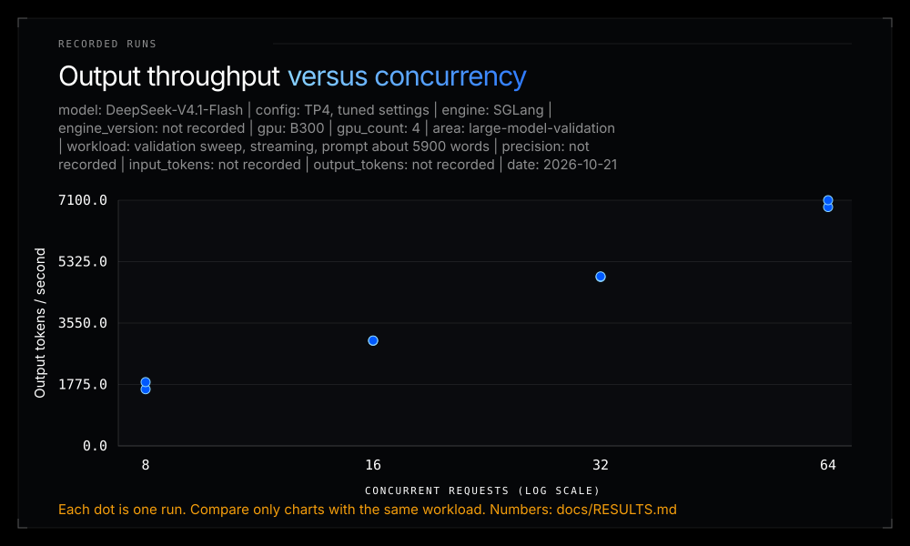

| Row | Concurrency | Output tok/s |
|---:|---:|---:|
| 204 | 8 | 1638 |
| 212 | 8 | 1843 |
| 206 | 16 | 3038 |
| 213 | 16 | 3046 |
| 208 | 32 | 4881 |
| 215 | 32 | 4898 |
| 210 | 64 | 6902 |
| 217 | 64 | 7100 |

### Context 085

**DeepSeek-V4.1-Flash** on **4x B300**, SGLang (version not recorded), 2026-10-21

**model**: DeepSeek-V4.1-Flash | **config**: TP4, tuned settings | **engine**: SGLang | **engine_version**: not recorded | **gpu**: B300 | **gpu_count**: 4 | **area**: large-model-validation | **workload**: validation sweep, streaming, prompt about 750 words | **precision**: not recorded | **input_tokens**: not recorded | **output_tokens**: not recorded | **date**: 2026-10-21

| Row | Concurrency | Output tok/s |
|---:|---:|---:|
| 203 | 8 | 1775 |
| 211 | 8 | 1869 |
| 205 | 16 | 3132 |
| 207 | 32 | 4369 |
| 214 | 32 | 4924 |
| 209 | 64 | 6007 |
| 216 | 64 | 7177 |

### Context 086

**GLM-5.3** on **4x B300**, SGLang (version not recorded), 2026-10-12

**model**: GLM-5.3 | **config**: TP4, 256k context | **engine**: SGLang | **engine_version**: not recorded | **gpu**: B300 | **gpu_count**: 4 | **area**: large-model-validation | **workload**: validation sweep, streaming, prompt about 5900 words | **precision**: not recorded | **input_tokens**: not recorded | **output_tokens**: not recorded | **date**: 2026-10-12

| Row | Concurrency | Output tok/s |
|---:|---:|---:|
| 476 | 8 | 990 |
| 478 | 16 | 1679 |
| 480 | 32 | 2661 |
| 482 | 64 | 4020 |

### Context 087

**GLM-5.3** on **4x B300**, SGLang (version not recorded), 2026-10-12

**model**: GLM-5.3 | **config**: TP4, 256k context | **engine**: SGLang | **engine_version**: not recorded | **gpu**: B300 | **gpu_count**: 4 | **area**: large-model-validation | **workload**: validation sweep, streaming, prompt about 750 words | **precision**: not recorded | **input_tokens**: not recorded | **output_tokens**: not recorded | **date**: 2026-10-12

| Row | Concurrency | Output tok/s |
|---:|---:|---:|
| 475 | 8 | 1087 |
| 477 | 16 | 1744 |
| 479 | 32 | 2846 |
| 481 | 64 | 4362 |

### Context 088

**GLM-5.3** on **4x B300**, SGLang (version not recorded), 2026-10-12

**model**: GLM-5.3 | **config**: TP4, cached-token reporting on | **engine**: SGLang | **engine_version**: not recorded | **gpu**: B300 | **gpu_count**: 4 | **area**: large-model-validation | **workload**: validation sweep, streaming, prompt about 5900 words | **precision**: not recorded | **input_tokens**: not recorded | **output_tokens**: not recorded | **date**: 2026-10-12

| Row | Concurrency | Output tok/s |
|---:|---:|---:|
| 484 | 8 | 998 |
| 486 | 16 | 1680 |
| 488 | 32 | 2703 |
| 490 | 64 | 3990 |

### Context 089

**GLM-5.3** on **4x B300**, SGLang (version not recorded), 2026-10-12

**model**: GLM-5.3 | **config**: TP4, cached-token reporting on | **engine**: SGLang | **engine_version**: not recorded | **gpu**: B300 | **gpu_count**: 4 | **area**: large-model-validation | **workload**: validation sweep, streaming, prompt about 750 words | **precision**: not recorded | **input_tokens**: not recorded | **output_tokens**: not recorded | **date**: 2026-10-12

| Row | Concurrency | Output tok/s |
|---:|---:|---:|
| 483 | 8 | 1087 |
| 485 | 16 | 1769 |
| 487 | 32 | 2807 |
| 489 | 64 | 4363 |

### Context 090

**GLM-5.3** on **4x B300**, SGLang (version not recorded), 2026-10-10

**model**: GLM-5.3 | **config**: TP4, tuned settings | **engine**: SGLang | **engine_version**: not recorded | **gpu**: B300 | **gpu_count**: 4 | **area**: large-model-validation | **workload**: validation sweep, streaming, prompt about 5900 words | **precision**: not recorded | **input_tokens**: not recorded | **output_tokens**: not recorded | **date**: 2026-10-10

| Row | Concurrency | Output tok/s |
|---:|---:|---:|
| 468 | 8 | 1013 |
| 470 | 16 | 1657 |
| 472 | 32 | 2702 |
| 474 | 64 | 3914 |

### Context 091

**GLM-5.3** on **4x B300**, SGLang (version not recorded), 2026-10-10

**model**: GLM-5.3 | **config**: TP4, tuned settings | **engine**: SGLang | **engine_version**: not recorded | **gpu**: B300 | **gpu_count**: 4 | **area**: large-model-validation | **workload**: validation sweep, streaming, prompt about 750 words | **precision**: not recorded | **input_tokens**: not recorded | **output_tokens**: not recorded | **date**: 2026-10-10

| Row | Concurrency | Output tok/s |
|---:|---:|---:|
| 467 | 8 | 1118 |
| 469 | 16 | 1764 |
| 471 | 32 | 2762 |
| 473 | 64 | 4377 |

### Context 092

**GLM-5.3-Flash** on **4x B300**, SGLang (version not recorded), 2026-10-21

**model**: GLM-5.3-Flash | **config**: TP4, tuned settings | **engine**: SGLang | **engine_version**: not recorded | **gpu**: B300 | **gpu_count**: 4 | **area**: large-model-validation | **workload**: validation sweep, streaming, prompt about 5900 words | **precision**: not recorded | **input_tokens**: not recorded | **output_tokens**: not recorded | **date**: 2026-10-21

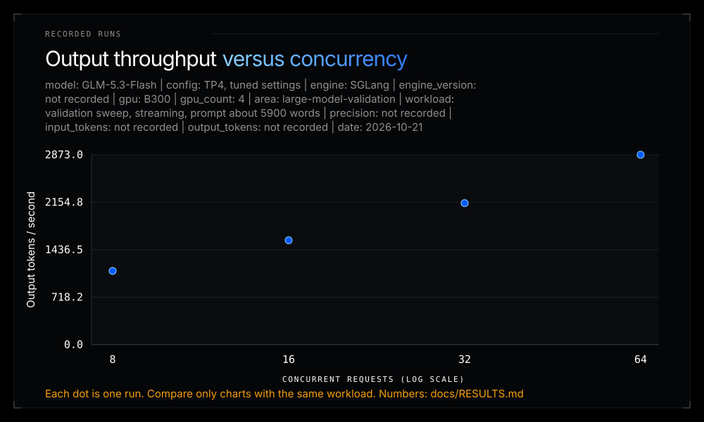

| Row | Concurrency | Output tok/s |
|---:|---:|---:|
| 386 | 8 | 1115 |
| 388 | 16 | 1579 |
| 390 | 32 | 2141 |
| 392 | 64 | 2873 |

### Context 093

**GLM-5.3-Flash** on **4x B300**, SGLang (version not recorded), 2026-10-21

**model**: GLM-5.3-Flash | **config**: TP4, tuned settings | **engine**: SGLang | **engine_version**: not recorded | **gpu**: B300 | **gpu_count**: 4 | **area**: large-model-validation | **workload**: validation sweep, streaming, prompt about 750 words | **precision**: not recorded | **input_tokens**: not recorded | **output_tokens**: not recorded | **date**: 2026-10-21

| Row | Concurrency | Output tok/s |
|---:|---:|---:|
| 385 | 8 | 739 |
| 387 | 16 | 1599 |
| 389 | 32 | 1865 |
| 391 | 64 | 2507 |

### Context 094

**Kimi-K2.7-Code** on **4x B300**, SGLang (version not recorded), 2026-10-12

**model**: Kimi-K2.7-Code | **config**: TP4, 256k context | **engine**: SGLang | **engine_version**: not recorded | **gpu**: B300 | **gpu_count**: 4 | **area**: large-model-validation | **workload**: validation sweep, streaming, prompt about 5900 words | **precision**: not recorded | **input_tokens**: not recorded | **output_tokens**: not recorded | **date**: 2026-10-12

| Row | Concurrency | Output tok/s |
|---:|---:|---:|
| 370 | 8 | 700 |
| 372 | 16 | 1313 |
| 374 | 32 | 2141 |
| 376 | 64 | 3234 |

### Context 095

**Kimi-K2.7-Code** on **4x B300**, SGLang (version not recorded), 2026-10-12

**model**: Kimi-K2.7-Code | **config**: TP4, 256k context | **engine**: SGLang | **engine_version**: not recorded | **gpu**: B300 | **gpu_count**: 4 | **area**: large-model-validation | **workload**: validation sweep, streaming, prompt about 750 words | **precision**: not recorded | **input_tokens**: not recorded | **output_tokens**: not recorded | **date**: 2026-10-12

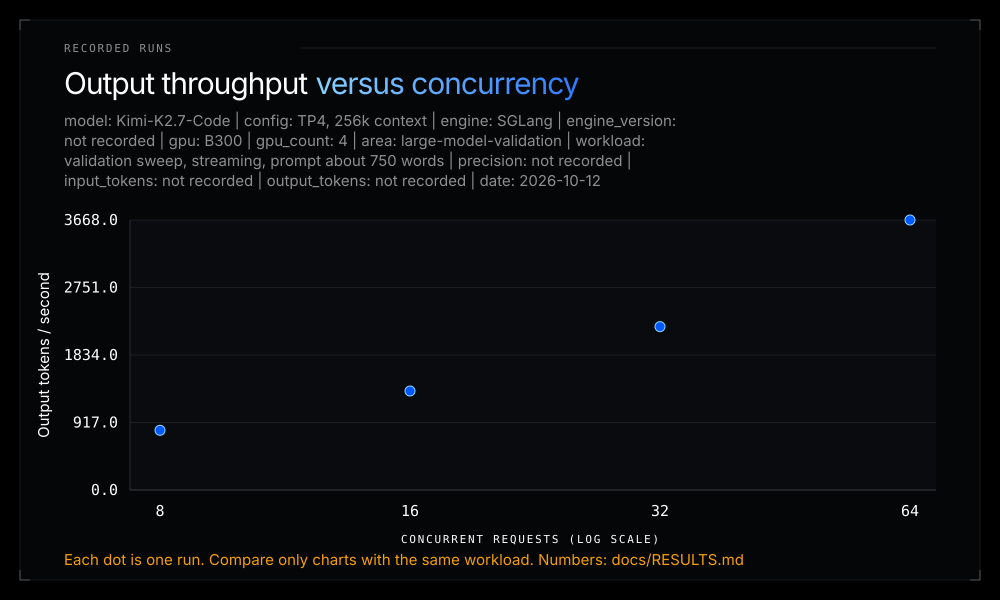

| Row | Concurrency | Output tok/s |
|---:|---:|---:|
| 369 | 8 | 811 |
| 371 | 16 | 1345 |
| 373 | 32 | 2219 |
| 375 | 64 | 3668 |

### Context 096

**Kimi-K2.7-Code** on **4x B300**, SGLang (version not recorded), 2026-10-12

**model**: Kimi-K2.7-Code | **config**: TP4, cached-token reporting on | **engine**: SGLang | **engine_version**: not recorded | **gpu**: B300 | **gpu_count**: 4 | **area**: large-model-validation | **workload**: validation sweep, streaming, prompt about 5900 words | **precision**: not recorded | **input_tokens**: not recorded | **output_tokens**: not recorded | **date**: 2026-10-12

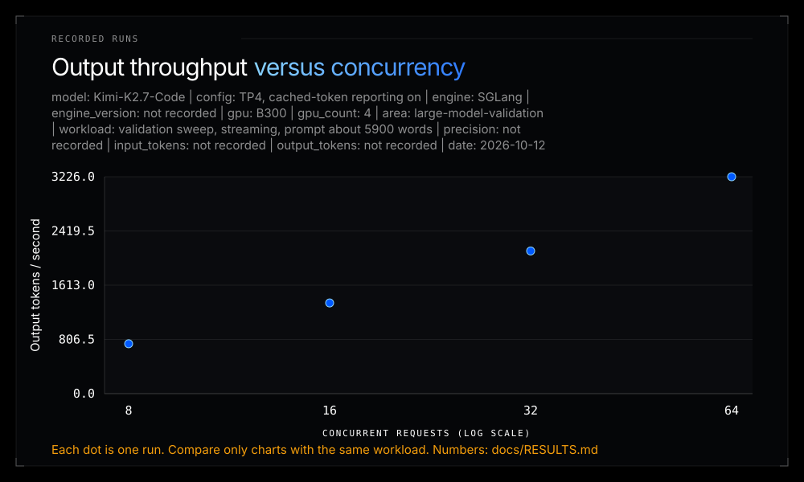

| Row | Concurrency | Output tok/s |
|---:|---:|---:|
| 378 | 8 | 742 |
| 380 | 16 | 1349 |
| 382 | 32 | 2122 |
| 384 | 64 | 3226 |

### Context 097

**Kimi-K2.7-Code** on **4x B300**, SGLang (version not recorded), 2026-10-12

**model**: Kimi-K2.7-Code | **config**: TP4, cached-token reporting on | **engine**: SGLang | **engine_version**: not recorded | **gpu**: B300 | **gpu_count**: 4 | **area**: large-model-validation | **workload**: validation sweep, streaming, prompt about 750 words | **precision**: not recorded | **input_tokens**: not recorded | **output_tokens**: not recorded | **date**: 2026-10-12

| Row | Concurrency | Output tok/s |
|---:|---:|---:|
| 377 | 8 | 809 |
| 379 | 16 | 1367 |
| 381 | 32 | 2217 |
| 383 | 64 | 3757 |

### Context 098

**Kimi-K2.7-Code** on **4x B300**, SGLang (version not recorded), 2026-10-10

**model**: Kimi-K2.7-Code | **config**: TP4, tuned settings | **engine**: SGLang | **engine_version**: not recorded | **gpu**: B300 | **gpu_count**: 4 | **area**: large-model-validation | **workload**: validation sweep, streaming, prompt about 5900 words | **precision**: not recorded | **input_tokens**: not recorded | **output_tokens**: not recorded | **date**: 2026-10-10

| Row | Concurrency | Output tok/s |
|---:|---:|---:|
| 362 | 8 | 742 |
| 364 | 16 | 1341 |
| 366 | 32 | 2126 |
| 368 | 64 | 3229 |

### Context 099

**Kimi-K2.7-Code** on **4x B300**, SGLang (version not recorded), 2026-10-10

**model**: Kimi-K2.7-Code | **config**: TP4, tuned settings | **engine**: SGLang | **engine_version**: not recorded | **gpu**: B300 | **gpu_count**: 4 | **area**: large-model-validation | **workload**: validation sweep, streaming, prompt about 750 words | **precision**: not recorded | **input_tokens**: not recorded | **output_tokens**: not recorded | **date**: 2026-10-10

| Row | Concurrency | Output tok/s |
|---:|---:|---:|
| 361 | 8 | 760 |
| 363 | 16 | 1398 |
| 365 | 32 | 2218 |
| 367 | 64 | 3547 |

## Single-node sweeps

November 2026 `vllm bench serve` sweeps and single-request image tests on one node.

### Context 100

**Llama-3.3-70B-Instruct-FP8-dynamic** on **1x H100 SXM**, vLLM (0.33.0), 2026-11-18

**model**: Llama-3.3-70B-Instruct-FP8-dynamic | **config**: not recorded | **engine**: vLLM | **engine_version**: 0.33.0 | **gpu**: H100 SXM | **gpu_count**: 1 | **area**: single-node-sweeps | **workload**: vllm bench serve, random prompts, ignore EOS, seed 0, prompts = max(8, 2 x concurrency) | **precision**: FP8 weights, 16-bit KV cache | **input_tokens**: 1000 | **output_tokens**: 500 | **date**: 2026-11-18

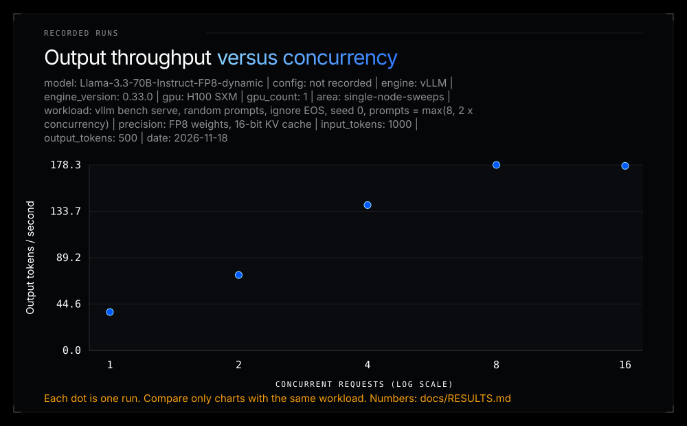

| Row | Concurrency | Output tok/s |
|---:|---:|---:|
| 268 | 1 | 36.9 |
| 269 | 2 | 72.5 |
| 270 | 4 | 139.7 |
| 271 | 8 | 178.3 |
| 272 | 16 | 177.4 |

### Context 101

**Llama-3.3-70B-Instruct-FP8-dynamic** on **1x H100 SXM**, vLLM (0.33.0), 2026-11-18

**model**: Llama-3.3-70B-Instruct-FP8-dynamic | **config**: not recorded | **engine**: vLLM | **engine_version**: 0.33.0 | **gpu**: H100 SXM | **gpu_count**: 1 | **area**: single-node-sweeps | **workload**: vllm bench serve, random prompts, ignore EOS, seed 0, prompts = max(8, 2 x concurrency) | **precision**: FP8 weights, FP8 KV cache | **input_tokens**: 1000 | **output_tokens**: 500 | **date**: 2026-11-18

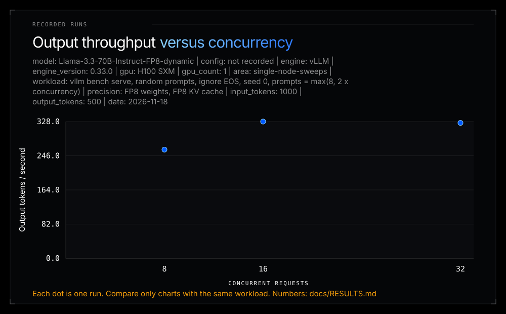

| Row | Concurrency | Output tok/s |
|---:|---:|---:|
| 273 | 8 | 260.7 |
| 274 | 16 | 328.0 |
| 275 | 32 | 324.8 |

### Context 102

**Llama-3.3-70B-Instruct-FP8-dynamic** on **1x RTX PRO 6000**, vLLM (0.33.0), 2026-11-18

**model**: Llama-3.3-70B-Instruct-FP8-dynamic | **config**: not recorded | **engine**: vLLM | **engine_version**: 0.33.0 | **gpu**: RTX PRO 6000 | **gpu_count**: 1 | **area**: single-node-sweeps | **workload**: vllm bench serve, random prompts, ignore EOS, seed 0, prompts = max(8, 2 x concurrency) | **precision**: FP8 weights, 16-bit KV cache | **input_tokens**: 1000 | **output_tokens**: 500 | **date**: 2026-11-18

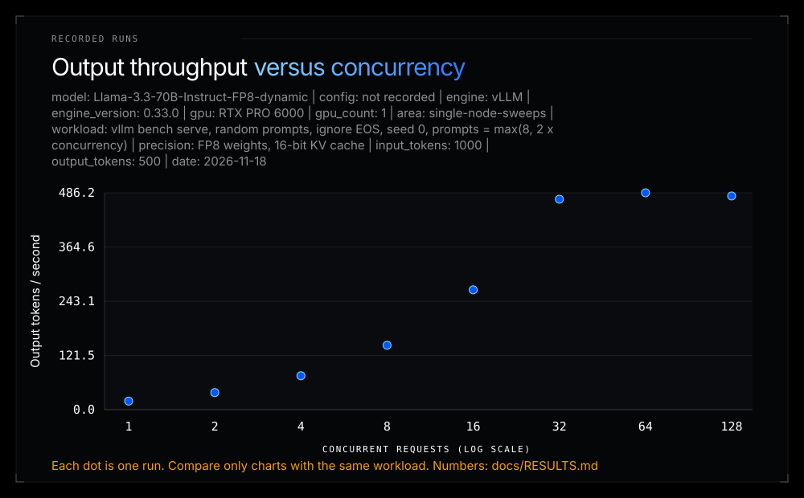

| Row | Concurrency | Output tok/s |
|---:|---:|---:|
| 276 | 1 | 19.2 |
| 277 | 2 | 38.3 |
| 278 | 4 | 76.0 |
| 279 | 8 | 144.3 |
| 280 | 16 | 268.6 |
| 281 | 32 | 471.8 |
| 282 | 64 | 486.2 |
| 283 | 128 | 479.1 |
